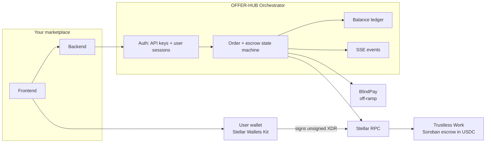

# OFFER-HUB Orchestrator

<p align="center">
  
  
  
  
  
</p>

```
 ██████╗ ██████╗ ███████╗███████╗██████╗       ██╗  ██╗██╗   ██╗██████╗
██╔═══██╗██╔════╝██╔════╝██╔════╝██╔══██╗      ██║  ██║██║   ██║██╔══██╗
██║   ██║█████╗  █████╗  █████╗  ██████╔╝█████╗███████║██║   ██║██████╔╝
██║   ██║██╔══╝  ██╔══╝  ██╔══╝  ██╔══██╗╚════╝██╔══██║██║   ██║██╔══██╗
╚██████╔╝██║     ███████╗███████╗██║  ██║      ██║  ██║╚██████╔╝██████╔╝
 ╚═════╝ ╚═╝     ╚══════╝╚══════╝╚═╝  ╚═╝      ╚═╝  ╚═╝ ╚═════╝ ╚═════╝
```

**OFFER-HUB Orchestrator** is a non-custodial escrow and payments orchestrator for marketplaces, built on Stellar. It gives your marketplace escrow-protected checkout in USDC, a user balance ledger, a structured dispute process, and an off-ramp to local bank rails — without giving you custody of anyone's funds.
**OFFER-HUB Orchestrator** is a self-hosted payments orchestration system designed for Marketplaces. It manages a Web2-like experience (balances, deposits, payments with escrow, and withdrawals) using **Stellar** wallets, **BlindPay** for bank payouts, and **Trustless Work** for non-custodial escrows on the Stellar network.

Mainnet is live, and there is a public testnet sandbox for development.

## Who it is for
- 💰 **User Balances**: Internal management of available and reserved balances.
- ⚡ **Deposits**: USDC deposits to each user's Stellar wallet.
- 🤝 **Smart Escrow**: Secure checkout with non-custodial escrow via TW.
- 💸 **Withdrawals**: USDC withdrawals to Stellar addresses and bank payouts through BlindPay.
- 🔐 **Secure & Audited**: Native idempotency, audit logs, and modular architecture.

Teams that run their own marketplace and want to add escrow payments without building a payments company. You keep your listings, accounts, messaging and UI; the Orchestrator handles the money movement and the escrow state machine.

## What it does today

| Capability | What you get |
|---|---|
| **Non-custodial escrow** | [Trustless Work](https://trustlesswork.com) Soroban escrows in USDC. Funds sit in the smart contract, not in your database. |
| **Client-side signing** | The Orchestrator prepares unsigned Stellar transactions. Users sign with their own wallet through [Stellar Wallets Kit](https://stellarwalletskit.dev) — Freighter/Varial, Lobstr or xBull. The server never signs for a user. |
| **Hybrid authentication** | API keys for your marketplace backend, plus user sessions. Wallet sign-in and email/password sign-in produce the same user JWT. |
| **Order lifecycle** | A single state machine from `ORDER_CREATED` to `CLOSED`, including escrow funding, delivery, release, refund and disputes. |
| **Disputes** | Buyer- or seller-opened disputes with a review step and full release, full refund or split outcomes. |
| **Off-ramp** | BlindPay payouts to four LATAM corridors: Brazil, Mexico, Argentina and Colombia. |
| **Real-time events** | An authenticated SSE stream for orders, balances and disputes. |
| **Audit and idempotency** | Prefixed IDs, structured envelopes, audit logging, and idempotency keys on the money-moving endpoints. |

The Orchestrator is not a custodian. It never holds user keys on mainnet, and it cannot move escrowed funds on its own.

## The public Orchestrator repository is a starter shell

[github.com/OFFER-HUB/OFFER-HUB](https://github.com/OFFER-HUB/OFFER-HUB) is the starter shell: the base a team clones to build its own marketplace on top of the Orchestrator. Treat it as a starting point you adapt, not as the full source of the hosted product.

This repository (`offer-hub-monorepo`) is the documentation and marketing site for the product, published at [offer-hub.tech](https://offer-hub.tech).

## Architecture at a glance



## Getting started

Read the documentation site:

- [Platform overview](https://offer-hub.tech/docs/getting-started) — what the product is and where to go next.
- [Installation](https://offer-hub.tech/docs/installation) — installer, manual setup, or SDK only.
- [Configuration](https://offer-hub.tech/docs/configuration) — environment variables for a self-hosted deployment.
- [Build your first marketplace](https://offer-hub.tech/docs/guide/build-your-first-marketplace) — end-to-end checkout with escrow.

Self-hosting in short:

```bash
git clone https://github.com/OFFER-HUB/OFFER-HUB.git
cd OFFER-HUB
npm install
cp .env.example .env
```

Set `OFFERHUB_MASTER_KEY=your-master-key`, run the database migrations, start the API, then use the master key once to create the first API key with `support` scope. Create separate `read` and `write` keys for your marketplace backend and keep them server-side.

## Packages
### Freelance Marketplace (Primary)
Connect freelancers with clients using escrow protection:
1. Client deposits USDC to their Stellar wallet
2. Client pays for project → funds go to escrow (Trustless Work)
3. Freelancer completes work
4. Client approves → funds released instantly to freelancer
5. Freelancer withdraws USDC or requests a bank payout through BlindPay

| Package | Version | Purpose |
|---|---|---|
| [`@offerhub/sdk`](https://www.npmjs.com/package/@offerhub/sdk) | 3.0.0 | TypeScript client for the Orchestrator API |
| [`@offerhub/cli`](https://www.npmjs.com/package/@offerhub/cli) | 1.0.0 | Command-line tool for API keys and maintenance |
| [`create-offer-hub-orchestrator`](https://www.npmjs.com/package/create-offer-hub-orchestrator) | 1.0.1 | Interactive installer for a self-hosted instance |

The SDK accepts two credential kinds: an API key (`ohk_live_...`) for backend use, or a short-lived token (`ohk_tok_...`) obtained by exchanging an API key. Use `sdk.asUser(token)` to act as a signed-in marketplace user.

## Repository layout

```
offer-hub-monorepo/
├── src/              # Next.js site: marketing pages + documentation website
├── backend/          # Standalone Express backend (own package.json)
├── mcp/              # MCP server exposing the docs to AI assistants (own package.json)
├── content/docs/     # Public documentation pages (MDX, rendered at /docs)
├── docs/             # Internal engineering documentation (Markdown)
├── config/           # Shared app-level config (security headers)
├── scripts/          # Build and codegen scripts (docs index, OpenAPI)
└── public/           # Static assets, including openapi.json
```

`backend/` and `mcp/` are independent packages. Each has its own `package.json` and needs its own `npm install`; see [`mcp/README.md`](./mcp/README.md).

## Development

The site runs on Next.js 15 and the test suite runs on Vitest. A plain `npm ci` is enough — no `.env` file, credentials or network access are required for the tests.

```bash
npm run dev           # documentation site on http://localhost:3000
npm run lint          # ESLint
npm run lint:classes  # guard against undefined Tailwind utility classes
npm test              # Vitest suite
npm run build         # production build
npm run docs:index    # regenerate the docs search index
```

Tests live in `__tests__/` folders beside the code they cover.

## Contributing

We welcome contributions. Read the [contributing guide](./docs/CONTRIBUTING.md) for conventions, then open a pull request against `main` using the repository template.

## Support

- Documentation: [offer-hub.tech/docs](https://offer-hub.tech/docs)
- Issues: [GitHub Issues](https://github.com/OFFER-HUB/offer-hub-monorepo/issues)
- Community: [Discord](https://discord.gg/yH4vBNWwc)

## Maintainers

- [@Josue19-08](https://github.com/Josue19-08) — Project Lead & Full-Stack Developer
- [@KevinMB0220](https://github.com/KevinMB0220) — Core Contributor & Developer
## 🙏 Acknowledgments

Built with ❤️ for the decentralized marketplace future.

- [NestJS](https://nestjs.com/) - Progressive Node.js framework
- [Prisma](https://www.prisma.io/) - Next-generation ORM
- [BullMQ](https://docs.bullmq.io/) - Premium message queue
- [BlindPay](https://www.blindpay.com/) - Bank payouts
- [Trustless Work](https://trustlesswork.com/) - Non-custodial escrow on Stellar

---

<p align="center">
  <i>Escrow payments for marketplaces, without the custody.</i>
</p>
