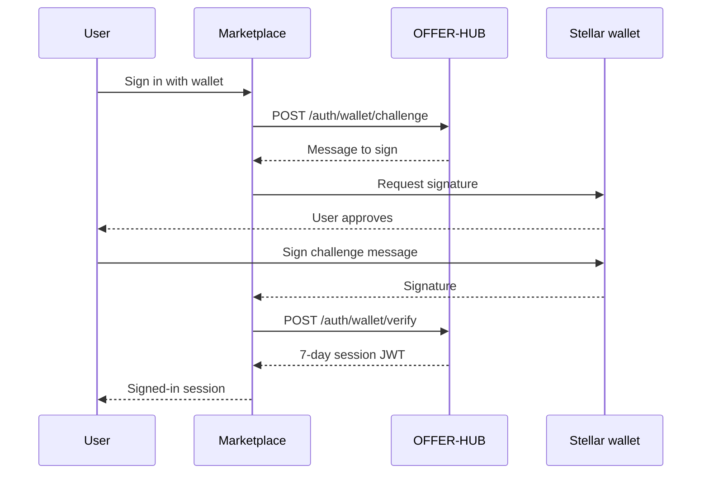

## Credential model

| Credential | Where it lives | Lifetime | Uses |
|---|---|---|---|
| API key (`ohk_live_…`) | Marketplace backend secrets | Long-lived | Create keys, mint short-lived tokens, create marketplace users |
| API-key token (`ohk_tok_…`) | Marketplace backend/SDK cache | 1 hour | Business endpoints; never use the API key directly |
| User session JWT | Signed-in user's session | 7 days | Orders, escrow, resolution, disputes, wallet, payouts, bank accounts, KYC |

The API key is exchanged with `POST /api/v1/auth/api-keys/:id/token` using `write` scope. The SDK caches and re-mints it. API-key values are never returned after creation.

## Marketplace API-key endpoints

| Method | Path | Auth | Request fields | Response fields |
|---|---|---|---|---|
| `POST` | `/api/v1/auth/api-keys` | API key, `support` | `name` string; `scopes` array (`read`, `write`, `support`) | `id`, `key`, `name`, `scopes`, plus response metadata |
| `GET` | `/api/v1/auth/api-keys` | API key, `support` | Query: `limit`; `cursor` | Key metadata: `id`, `name`, `scopes`, `lastUsedAt`, `createdAt`, pagination |
| `GET` | `/api/v1/auth/me` | API-key context | None | `apiKeyId`, `apiKeyName`, `scopes` |
| `POST` | `/api/v1/auth/api-keys/:id/token` | API key, `write` | Path: API-key `id`; no body | `token` (`ohk_tok_…`) |

Key values are omitted from list responses. The API-key token carries the source key's scopes and expires after one hour.

## User sign-in endpoints

| Method | Path | Auth | Request fields | Response fields |
|---|---|---|---|---|
| `POST` | `/api/v1/auth/wallet/challenge` | Public | Published wallet challenge fields (use the SDK method) | Challenge message to sign |
| `POST` | `/api/v1/auth/wallet/verify` | Public | Wallet address, signature, and challenge fields from the SDK | 7-day user session JWT |
| `POST` | `/api/v1/auth/register` | Public | Published registration fields (email and password) | User and 7-day session JWT |
| `POST` | `/api/v1/auth/login` | Public | Published login fields (email and password) | 7-day session JWT |
| `POST` | `/api/v1/auth/forgot-password` | Public | Email | Password-reset request result |
| `POST` | `/api/v1/auth/reset-password` | Public | Reset token and new password | Password-reset result |
| `GET` | `/api/v1/auth/verify-email` | Public | Verification token/query fields | Email-verification result |
| `POST` | `/api/v1/auth/send-verification` | JWT | Email or current-session identity, according to SDK types | Verification-request result |
| `POST` | `/api/v1/auth/change-password` | JWT | Current password and new password | Password-change result |

<Callout type="note">
Prefer `sdk.auth.walletChallenge(...)` and `sdk.auth.walletVerify(...)`. The maintainer is publishing `@offerhub/sdk` 3.0.0; until that release is available, use the maintainer-confirmed SDK signature for a method rather than inventing fields.
</Callout>

## Wallet sign-in sequence

Wallet sign-in and email/password sign-in produce the same session-JWT shape and 7-day lifetime.

## Session endpoints

| Method | Path | Auth | Request fields | Response fields |
|---|---|---|---|---|
| `GET` | `/api/v1/auth/sessions` | JWT | None | Session list |
| `DELETE` | `/api/v1/auth/sessions/:id` | JWT | Path: session `id` | Revocation result |
| `DELETE` | `/api/v1/auth/sessions` | JWT | None | All-session revocation result |

## OAuth endpoints

| Method | Path | Auth | Request fields | Response fields |
|---|---|---|---|---|
| `POST` | `/api/v1/auth/oauth/callback` | Public | Provider callback fields | 7-day session or OAuth callback result |
| `GET` | `/api/v1/auth/oauth/check-email` | Public | Email query parameter | Email availability/link status |
| `POST` | `/api/v1/auth/oauth/link` | JWT | Provider and provider account fields | Linked-account result |
| `DELETE` | `/api/v1/auth/oauth/link/:provider` | JWT | Path: `provider` | Unlink result |
| `GET` | `/api/v1/auth/oauth/linked-accounts` | JWT | None | Linked-account list |

## Marketplace user creation

| Method | Path | Auth | Request fields | Response fields |
|---|---|---|---|---|
| `POST` | `/api/v1/users` | API-key token, `write` | Published marketplace user fields: external identity, email, and `type` (`BUYER`, `SELLER`, or `BOTH`) | Marketplace user; no user-session JWT is returned |

<Callout type="warning">
Creating a marketplace user does not replace wallet or email sign-in. A created user must still obtain a 7-day JWT through wallet, email/password, or OAuth sign-in for user-resource endpoints.
</Callout>
