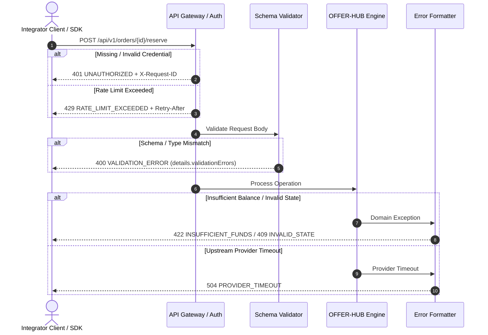

The OFFER-HUB Orchestrator returns standard, machine-readable JSON error envelopes for all failed requests. Every error includes a persistent machine code, a human-readable message, an optional domain-specific details payload, and a correlation request identifier.

The error code catalog is derived from the official OpenAPI specifications and published TypeScript SDK types (`@offerhub/sdk`). All error responses follow standard REST and JSON error envelopes.

## Error Response Envelope

All API error responses follow the standard envelope format:

```json
{
  "error": {
    "code": "INSUFFICIENT_FUNDS",
    "message": "Available balance is less than requested amount",
    "details": {
      "available": "50.00",
      "requested": "100.00",
      "currency": "USDC"
    }
  }
}
```

### Envelope Properties

| Field | Type | Required | Description |
| --- | --- | --- | --- |
| `error.code` | `string` | Yes | Canonical machine-readable error constant (e.g., `VALIDATION_ERROR`, `ORDER_NOT_FOUND`). Branch on this field in application code. |
| `error.message` | `string` | Yes | Human-readable explanation of the error condition. May change across versions; do not use for programmatic branching. |
| `error.details` | `object` | No | Structured contextual metadata providing field-level validation errors, current/allowed states, numerical limits, or provider error details. |

### Validation Errors Structure

When a request fails schema validation (`VALIDATION_ERROR`), the `details.validationErrors` array contains the exact property path and validation rule failure messages:

```json
{
  "error": {
    "code": "VALIDATION_ERROR",
    "message": "Validation failed",
    "details": {
      "validationErrors": [
        {
          "field": "amount",
          "message": "amount must be a decimal string formatted with 2 decimal places (e.g. \"100.00\")"
        },
        {
          "field": "sellerId",
          "message": "sellerId must be a valid user ID with usr_ prefix + 32 characters"
        }
      ]
    }
  }
}
```

## Request Correlation (X-Request-ID)

Every incoming request gets a correlation ID. It is either the incoming `X-Request-ID` header value, used as is, or a generated UUID v4.

The correlation ID is returned on every response in the `X-Request-ID` HTTP header and included in structured log lines:

```http
HTTP/1.1 422 Unprocessable Entity
Content-Type: application/json; charset=utf-8
X-Request-ID: req_8f7b2c9e4a1d48e2b13492c10b78e34a
```

<Callout type="tip">
  Always include the `X-Request-ID` header value when reporting unexpected errors (`500 INTERNAL_ERROR` or `502 PROVIDER_ERROR`) to support.
</Callout>

## Error Handling Flow

The diagram below illustrates how client requests traverse authentication, validation, core domain logic, and error handlers to produce structured error envelopes:



## SDK Error Mapping

When using `@offerhub/sdk` 3.0.0, the HTTP client inspects `error.code` and `statusCode` to raise typed JavaScript/TypeScript exception subclasses extending `OfferHubError`.

| Orchestrator Server Code | HTTP Status | SDK Exception Class | Description |
| --- | --- | --- | --- |
| `UNAUTHORIZED`, `INVALID_API_KEY`, `TOKEN_EXPIRED` | `401` | `AuthenticationError` | Missing, malformed, or expired credentials. |
| `INSUFFICIENT_SCOPE`, `USER_INACTIVE`, `UNAUTHORIZED_DISPUTE` | `403` | `AuthorizationError` | Valid credentials, but lacking permissions for resource or action. |
| `USER_NOT_FOUND`, `ORDER_NOT_FOUND`, `ESCROW_NOT_FOUND`, `DISPUTE_NOT_FOUND`, `WITHDRAWAL_NOT_FOUND`, `RESERVE_NOT_FOUND`, `WALLET_NOT_FOUND`, `MILESTONE_NOT_FOUND`, `PAYOUT_NOT_FOUND`, `BANK_ACCOUNT_NOT_FOUND`, `KYC_NOT_FOUND` | `404` | `NotFoundError` | The requested entity ID does not exist. |
| `VALIDATION_ERROR`, `INVALID_REQUEST`, `INVALID_AMOUNT_FORMAT`, `INVALID_CURRENCY`, `MISSING_REQUIRED_FIELD`, `INVALID_PAGINATION`, `INVALID_RESOLUTION`, `UNSUPPORTED_CORRIDOR` | `400` | `ValidationError` | Request payload failed field or format constraints. |
| `PAYOUTS_AMOUNT_BELOW_MINIMUM` | `400` | `ValidationError` | Payout quote is below the 5.00 USD minimum (or rail-specific threshold). |
| `LIMITS_VOLUME_EXCEEDED` | `403` | `AuthorizationError` | BlindPay receiver volume limit exceeded. |
| `INSUFFICIENT_FUNDS`, `RESERVE_MISMATCH_AMOUNT`, `WITHDRAWAL_DESTINATION_INVALID`, `TRUSTLINE_MISSING`, `INVALID_AMOUNT` | `422` | `InsufficientFundsError` / `OfferHubError` | Business rule rejected the transaction. |
| `INVALID_STATE`, `ORDER_NOT_IN_PROGRESS`, `ESCROW_NOT_READY`, `ESCROW_NOT_FUNDED` | `409` / `400` | `InvalidTransitionError` | State machine rejected the requested status transition. Note: no `CANCELLED` status exists; cancel moves order to `CLOSED`. |
| `BALANCE_CONCURRENCY_CONFLICT`, `BALANCE_DISCREPANCY` | `409` | `OfferHubError` | Optimistic lock conflict or local/provider balance discrepancy. |
| `IDEMPOTENCY_KEY_REUSED`, `IDEMPOTENCY_KEY_IN_PROGRESS`, `IDEMPOTENCY_CONFLICT` | `409` | `IdempotencyError` | Replay key collision or concurrent execution in progress. |
| `PROVIDER_ERROR`, `PROVIDER_TIMEOUT`, `PROVIDER_RATE_LIMITED`, `ESCROW_CREATE_FAILED`, `ESCROW_FUNDING_FAILED`, `PAYOUT_FAILED`, `WITHDRAWAL_FAILED` | `502` / `504` | `ProviderError` | Upstream provider (Trustless Work, BlindPay, Stellar RPC) failed. |
| `RATE_LIMIT_EXCEEDED`, `RATE_LIMITED` | `429` | `RateLimitError` | Request volume exceeded allocated per-minute bucket. |

---

## Complete Error Catalog by Domain

The tables below list error codes grouped by domain, mapping each canonical error code to its HTTP status, underlying trigger cause, and recommended resolution steps.

### 1. Authentication and Authorization (auth)

| Code | HTTP | Cause | How to Fix |
| --- | --- | --- | --- |
| `UNAUTHORIZED` | `401` | Missing, malformed, or empty `Authorization` header. | Supply header `Authorization: Bearer <token>` with valid API key or JWT. |
| `INVALID_API_KEY` | `401` | The API key token was not found or has been revoked. | Verify the key prefix (`ohk_live_`) or issue a new key with `POST /api/v1/auth/api-keys`. |
| `INSUFFICIENT_SCOPE` | `403` | The API key lacks the required scope (`read`, `write`, `support`). | Issue an API key containing the required scope. |
| `TOKEN_EXPIRED` | `401` | JWT session token has expired (valid 7 days) or 1-hour token expired. | Re-authenticate via wallet or login endpoint. |

### 2. Request Validation (validation)

| Code | HTTP | Cause | How to Fix |
| --- | --- | --- | --- |
| `VALIDATION_ERROR` | `400` | Request body or query parameters failed schema constraints. | Inspect `details.validationErrors` and correct invalid field types. |
| `INVALID_AMOUNT_FORMAT` | `400` | Amount passed without exactly 2 decimal places. | Format amount as decimal string with two decimals (e.g. `"100.00"`). |
| `INVALID_CURRENCY` | `400` | Currency code is unsupported. | Use supported currency (e.g., `USDC`, `USD`). |
| `MISSING_REQUIRED_FIELD` | `400` | Mandatory field was omitted or supplied as `null`. | Supply all mandatory payload fields. |
| `INVALID_PAGINATION` | `400` | Pagination `limit` is `< 1` or `> 100`, or `cursor` is malformed. | Set `limit` between 1 and 100; pass valid cursor. |

### 3. Users and Accounts (users)

| Code | HTTP | Cause | How to Fix |
| --- | --- | --- | --- |
| `USER_NOT_FOUND` | `404` | Target `userId` (`usr_...` + 32 chars) does not exist. | Confirm the user ID or create user via `POST /api/v1/users`. |
| `USER_ALREADY_EXISTS` | `409` | User with email or external identifier already exists. | Use existing user ID or register with unique identifier. |
| `USER_INACTIVE` | `403` | User account has been deactivated or suspended. | Reactivate user via support. |

### 4. Balances and Funds (funds)

| Code | HTTP | Cause | How to Fix |
| --- | --- | --- | --- |
| `INSUFFICIENT_FUNDS` | `422` | Available balance is less than requested reservation or debit. | Deposit funds via Stellar wallet or reduce amount. |
| `BALANCE_CONCURRENCY_CONFLICT` | `409` | Concurrent balance update during optimistic-lock update. | Refresh balance and re-evaluate before retrying. |
| `BALANCE_DISCREPANCY` | `409` | Local and provider balances differ by more than `$1.00`. | Reconcile local and provider balances via `POST /users/{id}/balance/reconcile`. |
| `FUNDS_ALREADY_RESERVED` | `409` | Funds for this order ID have already been reserved. | Proceed to escrow preparation (`POST /orders/{id}/escrow/prepare`). |
| `RESERVE_NOT_FOUND` | `404` | No active balance reservation found for order. | Call `POST /api/v1/orders/{id}/reserve` first. |
| `RESERVE_MISMATCH_AMOUNT` | `422` | Reserved amount does not match order amount. | Ensure reservation precisely matches order amount. |

### 5. Orders and State Machine (orders)

Order status flow: `ORDER_CREATED` -> `FUNDS_RESERVED` -> `ESCROW_CREATING` -> `ESCROW_FUNDING` -> `ESCROW_FUNDED` -> `IN_PROGRESS` -> `DELIVERED` -> `RELEASE_REQUESTED` -> `RELEASED` -> `CLOSED`. Refund path: `REFUND_REQUESTED` -> `REFUNDED`. Note: there is no `CANCELLED` status; cancellation moves order to `CLOSED`.

| Code | HTTP | Cause | How to Fix |
| --- | --- | --- | --- |
| `ORDER_NOT_FOUND` | `404` | Order ID (`ord_...` + 32 chars) does not exist. | Verify order identifier with `GET /api/v1/orders`. |
| `MILESTONE_NOT_FOUND` | `404` | Milestone ref does not exist on this order. | Check milestone references on the order. |
| `SAME_USER_ERROR` | `400` | Order created with same buyer and seller ID. | Supply distinct buyer and seller IDs. |
| `INVALID_STATE` | `409` | Requested action is not permitted in current order state. | Follow valid lifecycle: cancellation transitions to `CLOSED`. |
| `ORDER_NOT_IN_PROGRESS` | `409` | Action requires order to be in `IN_PROGRESS` status. | Ensure escrow is funded before milestone completion. |

### 6. Escrow Contracts (escrow)

Soroban smart contracts deployed via Trustless Work and settled in USDC.

| Code | HTTP | Cause | How to Fix |
| --- | --- | --- | --- |
| `ESCROW_NOT_FOUND` | `404` | Escrow record (`esc_...`) not found for order. | Prepare escrow contract via `POST /api/v1/orders/{id}/escrow/prepare`. |
| `ESCROW_ALREADY_EXISTS` | `409` | Escrow contract already prepared or deployed for order. | Proceed to funding with `POST /api/v1/orders/{id}/escrow/fund/prepare`. |
| `ESCROW_NOT_READY` | `409` | Escrow contract deployment is still pending on Stellar. | Wait for contract confirmation before funding. |
| `ESCROW_NOT_FUNDED` | `409` | Attempted release, refund, or dispute on unfunded escrow. | Complete funding via `POST /api/v1/orders/{id}/escrow/submit`. |
| `ESCROW_CREATE_FAILED` | `502` | Trustless Work or Stellar RPC rejected deployment. | Inspect provider error details and retry. |
| `ESCROW_FUNDING_FAILED` | `502` | On-chain transfer of USDC into escrow contract failed. | Check client wallet balance and signature, then retry. |

### 7. Disputes and Resolution (disputes)

| Code | HTTP | Cause | How to Fix |
| --- | --- | --- | --- |
| `DISPUTE_NOT_FOUND` | `404` | Dispute ID (`dsp_...`) does not exist. | Verify dispute identifier with `GET /api/v1/disputes`. |
| `DISPUTE_ALREADY_OPEN` | `409` | Active dispute already exists for this order. | Await review or cancel existing dispute. |
| `UNAUTHORIZED_DISPUTE` | `403` | Caller is neither the buyer nor seller on the order. | Dispute must be opened by order buyer or seller. |
| `INVALID_RESOLUTION` | `400` | Resolution parameters invalid. | Outcomes must be `FULL_RELEASE`, `FULL_REFUND`, or `SPLIT`. |
| `INVALID_AMOUNT` | `422` | Split amounts do not sum to total order amount. | Ensure buyer and seller split amounts equal total. |

### 8. BlindPay Payouts, KYC, and Bank Accounts (payouts)

BlindPay off-ramps in 4 LATAM corridors: Brazil (BR), Mexico (MX), Argentina (AR), Colombia (CO).

| Code | HTTP | Cause | How to Fix |
| --- | --- | --- | --- |
| `PAYOUT_NOT_FOUND` | `404` | Payout ID (`pay_...`) does not exist. | Verify payout ID with `GET /orders/{id}/payout`. |
| `PAYOUTS_AMOUNT_BELOW_MINIMUM` | `400` | Payout amount is below the minimum required for bank quotes. | Bank-account quotes require a minimum of 5.00 USD. Verify rail requirements. |
| `LIMITS_VOLUME_EXCEEDED` | `403` | Receiver transaction volume limit exceeded. | Request a limit increase through BlindPay's limit-increase process. |
| `UNSUPPORTED_CORRIDOR` | `400` | Bank account country is not supported. | Use one of the 4 supported corridors: Brazil, Mexico, Argentina, Colombia. |
| `BANK_ACCOUNT_NOT_FOUND` | `404` | Bank account ID (`ba_...`) does not exist. | Add account via `POST /api/v1/users/me/bank-accounts`. |
| `KYC_NOT_FOUND` | `404` | KYC profile (`kyc_...`) not initialized. | Complete KYC onboarding via `POST /api/v1/users/me/kyc`. |
| `TOS_NOT_ACCEPTED` | `403` | BlindPay Terms of Service not yet accepted. | Call `POST /api/v1/users/me/kyc/tos-accept`. |

### 9. Withdrawals and Stellar (withdrawals)

| Code | HTTP | Cause | How to Fix |
| --- | --- | --- | --- |
| `WITHDRAWAL_NOT_FOUND` | `404` | Withdrawal ID (`wd_...`) does not exist. | Verify ID with `GET /api/v1/withdrawals/{id}`. |
| `WITHDRAWAL_NOT_COMMITTABLE` | `409` | Withdrawal is not in committable state. | Check status with `GET /withdrawals/{id}`. |
| `WITHDRAWAL_DESTINATION_INVALID` | `422` | Stellar public key format is invalid. | Ensure Stellar address starts with `G` and is 56 characters. |
| `TRUSTLINE_MISSING` | `422` | Destination Stellar account lacks USDC trustline. | Establish USDC trustline before requesting withdrawal. |

### 10. Idempotency (idempotency)

Required on `POST /orders`, `POST /orders/{id}/escrow/submit`, and `POST /orders/{orderId}/payout/submit`.

| Code | HTTP | Cause | How to Fix |
| --- | --- | --- | --- |
| `IDEMPOTENCY_KEY_REUSED` | `409` | Same key replayed with different payload. | Use fresh UUID v4 for distinct mutations; reuse key only for retries. |
| `IDEMPOTENCY_KEY_IN_PROGRESS` | `409` | Mutation with this key is currently executing. | Wait 1-2 seconds and check resource status before retrying. |
| `IDEMPOTENCY_CONFLICT` | `409` | Concurrent conflicting mutation. | Fetch latest resource state with GET and re-apply. |

### 11. Rate Limiting and Infrastructure (system)

| Code | HTTP | Cause | How to Fix |
| --- | --- | --- | --- |
| `RATE_LIMIT_EXCEEDED` | `429` | Request volume exceeded allowed bucket (100 req/60s). | Check `X-RateLimit-Reset` and throttle client requests. |
| `RATE_LIMITED` | `429` | Client token bucket depleted. | Pause requests for seconds returned in Retry-After. |
| `INTERNAL_ERROR` | `500` | Unhandled server exception. | Provide `X-Request-ID` when reporting to support. |
| `DATABASE_ERROR` | `500` | Database connection error. | Retry request with exponential backoff. |
| `SERVICE_UNAVAILABLE` | `503` | Maintenance mode or dependency unavailable. | Check `GET /api/v1/health` and wait for maintenance window. |
| `PROVIDER_ERROR` | `502` | Upstream provider (Trustless Work, BlindPay, Stellar RPC) failed. | Inspect error details and retry with backoff. |
| `PROVIDER_TIMEOUT` | `504` | External provider failed to respond in time. | Check entity state before retrying mutation. |

---

## Related Documentation

- [API Reference Overview](/docs/api-reference/overview) - Base URL, authentication, headers, and idempotency
- [Config and Health](/docs/api-reference/config-and-health) - Platform configuration and basic health check
- [Events Reference](/docs/api-reference/events) - Real-time SSE event catalog
