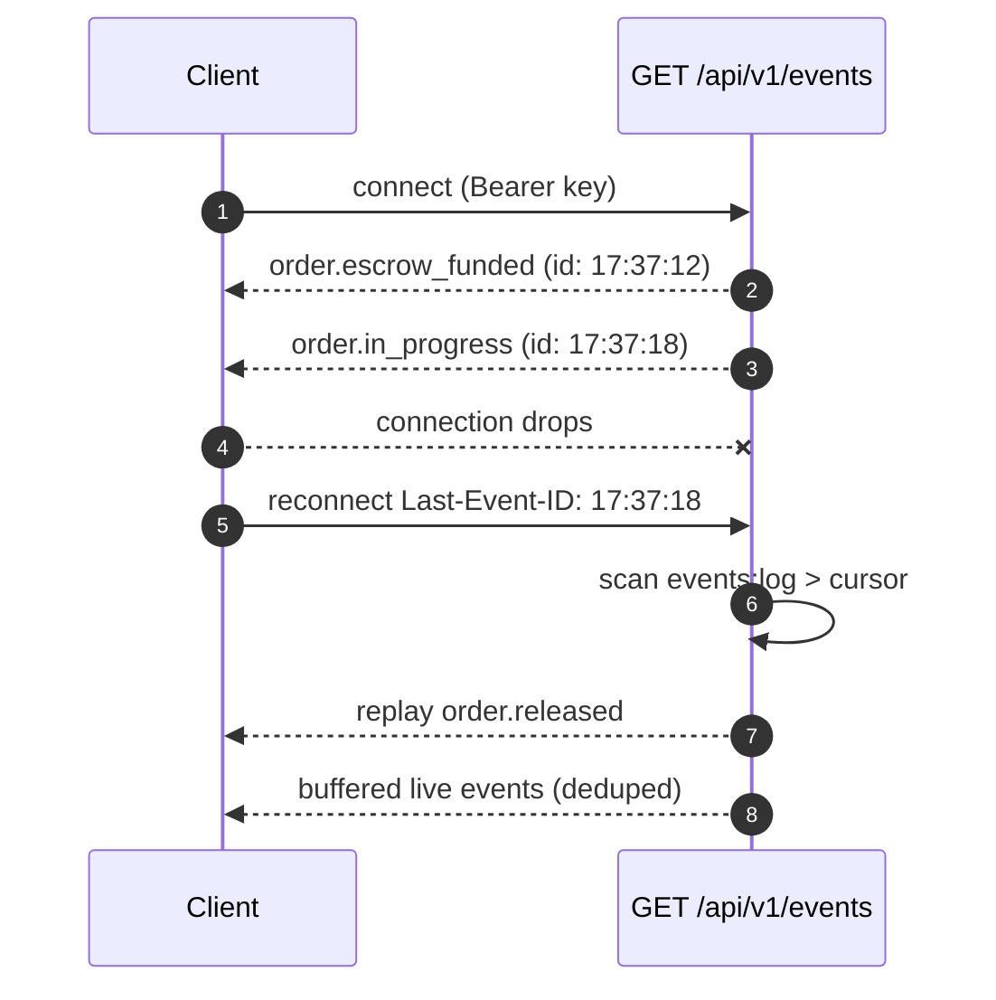

OFFER-HUB delivers real-time domain events over Server-Sent Events (SSE). Connect your marketplace backend once and react to changes such as a credited balance, funded escrow, or completed payout without polling.

<Callout type="note">
  This is an outbound stream from the Orchestrator. OFFER-HUB does not send outbound webhooks to your application: integrations subscribe to the SSE stream using a scoped API key token.
</Callout>

## Subscribe to the event stream

<Badge variant="success">GET</Badge> `/api/v1/events`

Authenticate with a valid API key in the `Authorization` header:

```
Authorization: Bearer ohk_live_...
```

The route is protected by `ApiKeyGuard` with `read` scope. `EventsController.streamEvents` in the Orchestrator (`apps/api/src/modules/events/events.controller.ts`) verifies the credential and streams events scoped to the caller's marketplace.

```bash
curl -N \
  -H "Authorization: Bearer ohk_live_..." \
  -H "Accept: text/event-stream" \
  "http://localhost:4000/api/v1/events"
```

`-N` keeps curl from buffering the stream.

### Marketplace isolation

Events are scoped to the marketplace bound to your API key. The controller reads `apiKey.marketplaceId` and `SseService.getEventStream` drops every event whose `metadata.marketplaceId` does not match (`apps/api/src/modules/events/sse.service.ts`). Each marketplace only ever receives its own events: even with a replay request.

### Filter the stream

Use repeated query parameters to filter by exact event or aggregate type:

```bash
curl -N \
  -H "Authorization: Bearer ohk_live_..." \
  "http://localhost:4000/api/v1/events?types=order.created&types=order.closed&resources=Order"
```

| Parameter | Values | Description |
| --- | --- | --- |
| `types` | One or more exact event types | Includes only events with a matching `eventType`. |
| `resources` | One or more aggregate types, such as `Order` or `Balance` | Includes only events with a matching `aggregateType`. |
| `since` | ISO 8601 timestamp | Replays buffered events after the timestamp when no `Last-Event-ID` header is supplied. |

<Callout type="warning">
  SSE filters use exact matches (`filters.types.includes(event.eventType)` against the values you send). Wildcard patterns (`order.*`, `*`) exist only on the internal event bus.
</Callout>

## Event envelope

Every event is a `DomainEvent`. `payload` varies by `eventType`; the remaining fields use the same shape for every event (`apps/api/src/modules/events/types/domain-event.ts`).

```typescript
interface DomainEvent<T = unknown> {
  eventId: string;           // "evt_..." - unique, for dedup
  eventType: string;         // "order.escrow_funded" - from the catalog below
  occurredAt: string;        // ISO 8601 timestamp
  aggregateId: string;       // ID of the resource that produced the event
  aggregateType: string;     // "Order", "Balance", "Payout", ...
  payload: T;                // Event-specific data (see catalog below)
  metadata: {
    correlationId?: string;  // Request ID that triggered the event
    causationId?: string;    // ID of the event that caused this one
    userId?: string;         // User who triggered the action
    marketplaceId?: string;  // Used for marketplace isolation
    [key: string]: unknown;
  };
}
```

| Field | Type | Description |
| --- | --- | --- |
| `eventId` | string | Unique event identifier, generated with the `evt_` prefix + 32 random characters. Use it for deduplication. |
| `eventType` | string | The event name from the catalog below, such as `order.escrow_funded`. |
| `occurredAt` | string | ISO 8601 timestamp at which the event was emitted. |
| `aggregateId` | string | ID of the resource that produced the event. |
| `aggregateType` | string | Resource type, such as `Order`, `Balance`, or `Payout`. |
| `payload` | object | Data specific to the event type. |
| `metadata` | object | Correlation, causation, user, marketplace, and any additional context. |

On the wire, each SSE message uses the event's timestamp as its SSE `id`, its `eventType` as the SSE event name, and the complete envelope as JSON `data`:

```text
id: 2026-02-18T17:37:12.000Z
event: order.escrow_funded
data: {"eventId":"evt_102030405060708090a0b0c0d0e0f010","eventType":"order.escrow_funded","occurredAt":"2026-02-18T17:37:12.000Z","aggregateId":"ord_1a2b3c4d5e6f7a8b9c0d1e2f3a4b5c6d","aggregateType":"Order","payload":{"orderId":"ord_1a2b3c4d5e6f7a8b9c0d1e2f3a4b5c6d","escrowId":"esc_8a7b6c5d4e3f2a1b0c9d8e7f6a5b4c3d","amount":"2500.00","currency":"USDC"},"metadata":{}}
```

### Heartbeat

The server sends a `ping` event every **30 seconds** (`interval(30000)` in `EventsController`) to keep an idle connection alive:

```text
event: ping
data: {"ping":true,"timestamp":"2026-02-18T17:37:42.000Z"}
```

The ping has no `eventId`: ignore it rather than treating it as a domain event.

### Reconnect and replay

Missed events are replayed from a Redis sorted set (`events:log`) scored by `occurredAt`, **capped at the last 1,000 events** (`SseService.MAX_EVENTS`, `apps/api/src/modules/events/sse.service.ts`). To resume after a disconnect, send the `id` of the last event you received in the standard `Last-Event-ID` header. This header takes precedence over the `since` query parameter:

```bash
curl -N \
  -H "Authorization: Bearer ohk_live_..." \
  -H "Last-Event-ID: 2026-02-18T17:37:12.000Z" \
  "http://localhost:4000/api/v1/events"
```

Replay is **exclusive** of the cursor timestamp, so the event you already processed is not re-sent. While history is being replayed, live events are buffered at the connection and de-duplicated against the history by `eventId`, closing the gap between `Last-Event-ID` and reconnection.

Treat the stream as at-least-once delivery: persist processed `eventId` values and ignore a duplicate before performing side effects.

## Reconnection example

A resilient subscriber reconnects on error, passes the last `eventId` back as `Last-Event-ID`, and ignores duplicates:

```typescript
import { EventSource } from 'eventsource';

class EventSubscriber {
  private url = 'http://localhost:4000/api/v1/events';
  private lastEventId?: string;
  private processed = new Set<string>();

  connect() {
    const headers = { Authorization: 'Bearer ohk_live_...' };
    if (this.lastEventId) {
      (headers as Record<string, string>)['Last-Event-ID'] = this.lastEventId;
    }

    const es = new EventSource(this.url, { headers });

    es.onmessage = (message) => {
      if (message.lastEventId) this.lastEventId = message.lastEventId;
      const event = JSON.parse(message.data);
      if (this.processed.has(event.eventId)) return;
      this.processed.add(event.eventId);
      this.handle(event);
    };

    es.onerror = () => {
      // EventSource auto-reconnects; the next connection replays from lastEventId
    };
  }

  handle(event: any) {
    console.log('Received event:', event.eventType, event.payload);
  }
}
```

### Using the SDK

```typescript
import { OfferHubSDK } from '@offerhub/sdk';

const sdk = new OfferHubSDK({
  apiUrl: 'http://localhost:4000',
  apiKey: 'ohk_live_your_api_key'
});

const events = sdk.events.subscribe();

events.on('order.escrow_funded', (data) => {
  console.log('Escrow funded:', data);
});

events.on('payout.completed', (data) => {
  console.log('Payout completed:', data);
});
```

## Event catalog

### Replay Sequence



The catalog below is derived from the Orchestrator's domain events. Optional fields are suffixed with `?`.

### User and wallet events

| Event | Payload |
| --- | --- |
| `user.created` | `{ userId, externalUserId, email?, type, status }` |
| `wallet.connected` | `{ walletId, userId, address, walletType, provider }` |
| `wallet.disconnected` | `{ walletId, userId, address }` |
| `wallet.primary_changed` | `{ userId, primaryAddress }` |

```json
{
  "user.created": { "userId": "usr_9f2c1a7e5b3d8f6041c2a9e7b5d3f1a0", "externalUserId": "buyer_001", "email": "buyer@example.com", "type": "BUYER", "status": "ACTIVE" },
  "wallet.connected": { "walletId": "wal_4b5c6d7e8f9a0b1c2d3e4f5a6b7c8d9e", "userId": "usr_9f2c1a7e5b3d8f6041c2a9e7b5d3f1a0", "address": "GABCMX76J6XFMH67QJ5J4K2VXZ4QW6A6Y...", "walletType": "EXTERNAL", "provider": "freighter" },
  "wallet.disconnected": { "walletId": "wal_4b5c6d7e8f9a0b1c2d3e4f5a6b7c8d9e", "userId": "usr_9f2c1a7e5b3d8f6041c2a9e7b5d3f1a0", "address": "GABCMX76J6XFMH67QJ5J4K2VXZ4QW6A6Y..." },
  "wallet.primary_changed": { "userId": "usr_9f2c1a7e5b3d8f6041c2a9e7b5d3f1a0", "primaryAddress": "GABCMX76J6XFMH67QJ5J4K2VXZ4QW6A6Y..." }
}
```

### Balance events

| Event | Payload |
| --- | --- |
| `balance.credited` | `{ userId, amount, currency, source, sourceId?, previousAvailableBalance, newAvailableBalance }` |
| `balance.debited` | `{ userId, amount, currency, destination, destinationId?, previousAvailableBalance, newAvailableBalance }` |
| `balance.reserved` | `{ userId, amount, currency, orderId, previousReservedBalance, newReservedBalance, previousAvailableBalance, newAvailableBalance }` |
| `balance.released` | `{ userId, amount, currency, orderId, reason, previousReservedBalance, newReservedBalance, previousAvailableBalance, newAvailableBalance }` |

```json
{
  "balance.credited": { "userId": "usr_9f2c1a7e5b3d8f6041c2a9e7b5d3f1a0", "amount": "250.00", "currency": "USDC", "source": "release", "sourceId": "ord_1a2b3c4d5e6f7a8b9c0d1e2f3a4b5c6d", "previousAvailableBalance": "1000.00", "newAvailableBalance": "1250.00" },
  "balance.debited": { "userId": "usr_9f2c1a7e5b3d8f6041c2a9e7b5d3f1a0", "amount": "100.00", "currency": "USDC", "destination": "withdrawal", "destinationId": "wd_2b3c4d5e6f7a8b9c0d1e2f3a4b5c6d7e", "previousAvailableBalance": "1250.00", "newAvailableBalance": "1150.00" },
  "balance.reserved": { "userId": "usr_9f2c1a7e5b3d8f6041c2a9e7b5d3f1a0", "amount": "200.00", "currency": "USDC", "orderId": "ord_1a2b3c4d5e6f7a8b9c0d1e2f3a4b5c6d", "previousReservedBalance": "0.00", "newReservedBalance": "200.00", "previousAvailableBalance": "1150.00", "newAvailableBalance": "950.00" },
  "balance.released": { "userId": "usr_9f2c1a7e5b3d8f6041c2a9e7b5d3f1a0", "amount": "200.00", "currency": "USDC", "orderId": "ord_1a2b3c4d5e6f7a8b9c0d1e2f3a4b5c6d", "reason": "escrow_funded", "previousReservedBalance": "200.00", "newReservedBalance": "0.00", "previousAvailableBalance": "950.00", "newAvailableBalance": "1150.00" }
}
```

### Order events

Order state machine transitions emit real-time events. (Note: There is no `CANCELLED` status: cancelled orders transition directly to `CLOSED`).

| Event | Payload |
| --- | --- |
| `order.created` | `{ orderId, buyerId, sellerId, amount, currency, title, description? }` |
| `order.funds_reserved` | `{ orderId, buyerId, amount, currency, reservedBalance, availableBalance }` |
| `order.escrow_creating` | `{ orderId, escrowId, amount }` |
| `order.escrow_funding` | `{ orderId, escrowId, trustlessContractId, amount }` |
| `order.escrow_funded` | `{ orderId, escrowId, trustlessContractId, amount, fundedAt }` |
| `order.in_progress` | `{ orderId, escrowId }` |
| `order.delivered` | `{ orderId, deliveredAt }` |
| `order.release_requested` | `{ orderId, requestedBy, requestedAt }` |
| `order.released` | `{ orderId, sellerId, amount, currency, releasedAt }` |
| `order.refund_requested` | `{ orderId, requestedBy, requestedAt }` |
| `order.refunded` | `{ orderId, buyerId, amount, currency, refundedAt }` |
| `order.disputed` | `{ orderId, disputeId, openedBy, reason, openedAt }` |
| `order.closed` | `{ orderId, finalStatus, closedAt }` |

```json
{
  "order.created": { "orderId": "ord_1a2b3c4d5e6f7a8b9c0d1e2f3a4b5c6d", "buyerId": "usr_9f2c1a7e5b3d8f6041c2a9e7b5d3f1a0", "sellerId": "usr_7b8c9d0e1f2a3b4c5d6e7f8a9b0c1d2e", "amount": "2500.00", "currency": "USDC", "title": "Smart contract audit" },
  "order.funds_reserved": { "orderId": "ord_1a2b3c4d5e6f7a8b9c0d1e2f3a4b5c6d", "buyerId": "usr_9f2c1a7e5b3d8f6041c2a9e7b5d3f1a0", "amount": "2500.00", "currency": "USDC", "reservedBalance": "2500.00", "availableBalance": "5000.00" },
  "order.escrow_funded": { "orderId": "ord_1a2b3c4d5e6f7a8b9c0d1e2f3a4b5c6d", "escrowId": "esc_8a7b6c5d4e3f2a1b0c9d8e7f6a5b4c3d", "trustlessContractId": "CA3D5K...", "amount": "2500.00", "fundedAt": "2026-02-18T17:37:12.000Z" },
  "order.in_progress": { "orderId": "ord_1a2b3c4d5e6f7a8b9c0d1e2f3a4b5c6d", "escrowId": "esc_8a7b6c5d4e3f2a1b0c9d8e7f6a5b4c3d" },
  "order.delivered": { "orderId": "ord_1a2b3c4d5e6f7a8b9c0d1e2f3a4b5c6d", "deliveredAt": "2026-02-19T10:00:00.000Z" },
  "order.released": { "orderId": "ord_1a2b3c4d5e6f7a8b9c0d1e2f3a4b5c6d", "sellerId": "usr_7b8c9d0e1f2a3b4c5d6e7f8a9b0c1d2e", "amount": "2500.00", "currency": "USDC", "releasedAt": "2026-02-19T12:00:00.000Z" },
  "order.refunded": { "orderId": "ord_1a2b3c4d5e6f7a8b9c0d1e2f3a4b5c6d", "buyerId": "usr_9f2c1a7e5b3d8f6041c2a9e7b5d3f1a0", "amount": "2500.00", "currency": "USDC", "refundedAt": "2026-02-19T12:00:00.000Z" },
  "order.disputed": { "orderId": "ord_1a2b3c4d5e6f7a8b9c0d1e2f3a4b5c6d", "disputeId": "dsp_1f2e3d4c5b6a708990a1b2c3d4e5f6a7", "openedBy": "BUYER", "reason": "NOT_DELIVERED", "openedAt": "2026-02-19T10:00:00.000Z" },
  "order.closed": { "orderId": "ord_1a2b3c4d5e6f7a8b9c0d1e2f3a4b5c6d", "finalStatus": "CLOSED", "closedAt": "2026-02-19T12:05:00.000Z" }
}
```

### Escrow events

| Event | Payload |
| --- | --- |
| `escrow.created` | `{ escrowId, orderId, amount, currency }` |
| `escrow.funding_started` | `{ escrowId, orderId, trustlessContractId, amount }` |
| `escrow.funded` | `{ escrowId, orderId, trustlessContractId, amount, fundedAt }` |
| `escrow.milestone_completed` | `{ escrowId, orderId, milestoneRef, completedAt }` |
| `escrow.released` | `{ escrowId, orderId, sellerId, amount, releasedAt }` |
| `escrow.refunded` | `{ escrowId, orderId, buyerId, amount, refundedAt }` |

```json
{
  "escrow.created": { "escrowId": "esc_8a7b6c5d4e3f2a1b0c9d8e7f6a5b4c3d", "orderId": "ord_1a2b3c4d5e6f7a8b9c0d1e2f3a4b5c6d", "amount": "2500.00", "currency": "USDC" },
  "escrow.funded": { "escrowId": "esc_8a7b6c5d4e3f2a1b0c9d8e7f6a5b4c3d", "orderId": "ord_1a2b3c4d5e6f7a8b9c0d1e2f3a4b5c6d", "trustlessContractId": "CA3D5K...", "amount": "2500.00", "fundedAt": "2026-02-18T17:37:12.000Z" },
  "escrow.released": { "escrowId": "esc_8a7b6c5d4e3f2a1b0c9d8e7f6a5b4c3d", "orderId": "ord_1a2b3c4d5e6f7a8b9c0d1e2f3a4b5c6d", "sellerId": "usr_7b8c9d0e1f2a3b4c5d6e7f8a9b0c1d2e", "amount": "2500.00", "releasedAt": "2026-02-19T12:00:00.000Z" }
}
```

### Dispute events

| Event | Payload |
| --- | --- |
| `dispute.opened` | `{ disputeId, orderId, openedBy, reason, openedAt }` |
| `dispute.under_review` | `{ disputeId, orderId, reviewStartedAt }` |
| `dispute.resolved` | `{ disputeId, orderId, outcome, resolvedAt, buyerAmount?, sellerAmount? }` |
| `dispute.cancelled` | `{ disputeId, orderId, cancelledAt }` |

```json
{
  "dispute.opened": { "disputeId": "dsp_1f2e3d4c5b6a708990a1b2c3d4e5f6a7", "orderId": "ord_1a2b3c4d5e6f7a8b9c0d1e2f3a4b5c6d", "openedBy": "BUYER", "reason": "NOT_DELIVERED", "openedAt": "2026-02-19T10:00:00.000Z" },
  "dispute.under_review": { "disputeId": "dsp_1f2e3d4c5b6a708990a1b2c3d4e5f6a7", "orderId": "ord_1a2b3c4d5e6f7a8b9c0d1e2f3a4b5c6d", "reviewStartedAt": "2026-02-19T11:00:00.000Z" },
  "dispute.resolved": { "disputeId": "dsp_1f2e3d4c5b6a708990a1b2c3d4e5f6a7", "orderId": "ord_1a2b3c4d5e6f7a8b9c0d1e2f3a4b5c6d", "outcome": "FULL_REFUND", "resolvedAt": "2026-02-19T14:00:00.000Z", "buyerAmount": "2500.00" },
  "dispute.cancelled": { "disputeId": "dsp_1f2e3d4c5b6a708990a1b2c3d4e5f6a7", "orderId": "ord_1a2b3c4d5e6f7a8b9c0d1e2f3a4b5c6d", "cancelledAt": "2026-02-19T11:30:00.000Z" }
}
```

### Payout events (BlindPay off-ramp)

BlindPay off-ramp events update order payout status in real-time across the 4 supported corridors (Brazil, Mexico, Argentina, Colombia).

| Event | Payload |
| --- | --- |
| `payout.new` | `{ payoutId, orderId, amount, currency, bankAccountId, corridor }` |
| `payout.update` | `{ payoutId, orderId, status }` |
| `payout.completed` | `{ payoutId, orderId, amount, fiatAmount, fiatCurrency, completedAt }` |
| `payout.failed` | `{ payoutId, orderId, amount, reason, errorCode? }` |
| `payout.on_hold` | `{ payoutId, orderId, reason }` |
| `payout.refunded` | `{ payoutId, orderId, amount, refundedAt }` |

```json
{
  "payout.new": { "payoutId": "pay_3d4e5f6a7b8c9d0e1f2a3b4c5d6e7f8a", "orderId": "ord_1a2b3c4d5e6f7a8b9c0d1e2f3a4b5c6d", "amount": "2500.00", "currency": "USDC", "bankAccountId": "ba_7c8d9e0f1a2b3c4d5e6f7a8b9c0d1e2f", "corridor": "BR" },
  "payout.update": { "payoutId": "pay_3d4e5f6a7b8c9d0e1f2a3b4c5d6e7f8a", "orderId": "ord_1a2b3c4d5e6f7a8b9c0d1e2f3a4b5c6d", "status": "PROCESSING" },
  "payout.completed": { "payoutId": "pay_3d4e5f6a7b8c9d0e1f2a3b4c5d6e7f8a", "orderId": "ord_1a2b3c4d5e6f7a8b9c0d1e2f3a4b5c6d", "amount": "2500.00", "fiatAmount": "12500.00", "fiatCurrency": "BRL", "completedAt": "2026-02-19T15:00:00.000Z" },
  "payout.failed": { "payoutId": "pay_3d4e5f6a7b8c9d0e1f2a3b4c5d6e7f8a", "orderId": "ord_1a2b3c4d5e6f7a8b9c0d1e2f3a4b5c6d", "amount": "2500.00", "reason": "Bank account rejected transaction", "errorCode": "PAYOUT_FAILED" },
  "payout.on_hold": { "payoutId": "pay_3d4e5f6a7b8c9d0e1f2a3b4c5d6e7f8a", "orderId": "ord_1a2b3c4d5e6f7a8b9c0d1e2f3a4b5c6d", "reason": "Receiver compliance review in progress" },
  "payout.refunded": { "payoutId": "pay_3d4e5f6a7b8c9d0e1f2a3b4c5d6e7f8a", "orderId": "ord_1a2b3c4d5e6f7a8b9c0d1e2f3a4b5c6d", "amount": "2500.00", "refundedAt": "2026-02-19T16:00:00.000Z" }
}
```

### Withdrawal events

| Event | Payload |
| --- | --- |
| `withdrawal.created` | `{ withdrawalId, userId, amount, currency, destinationAddress }` |
| `withdrawal.committed` | `{ withdrawalId, userId, amount, currency }` |
| `withdrawal.completed` | `{ withdrawalId, userId, amount, currency, completedAt }` |
| `withdrawal.failed` | `{ withdrawalId, userId, amount, reason, errorCode? }` |

```json
{
  "withdrawal.created": { "withdrawalId": "wd_2b3c4d5e6f7a8b9c0d1e2f3a4b5c6d7e", "userId": "usr_9f2c1a7e5b3d8f6041c2a9e7b5d3f1a0", "amount": "80.00", "currency": "USDC", "destinationAddress": "GABCMX76J6XFMH67QJ5J4K2VXZ4QW6A6Y..." },
  "withdrawal.committed": { "withdrawalId": "wd_2b3c4d5e6f7a8b9c0d1e2f3a4b5c6d7e", "userId": "usr_9f2c1a7e5b3d8f6041c2a9e7b5d3f1a0", "amount": "80.00", "currency": "USDC" },
  "withdrawal.completed": { "withdrawalId": "wd_2b3c4d5e6f7a8b9c0d1e2f3a4b5c6d7e", "userId": "usr_9f2c1a7e5b3d8f6041c2a9e7b5d3f1a0", "amount": "80.00", "currency": "USDC", "completedAt": "2026-02-19T15:00:00.000Z" },
  "withdrawal.failed": { "withdrawalId": "wd_2b3c4d5e6f7a8b9c0d1e2f3a4b5c6d7e", "userId": "usr_9f2c1a7e5b3d8f6041c2a9e7b5d3f1a0", "amount": "80.00", "reason": "Destination account missing USDC trustline", "errorCode": "TRUSTLINE_MISSING" }
}
```

## Handle named SSE events

SSE messages are emitted with the catalog value as their event name (`type`). Register a listener for that name and parse the envelope from `event.data`:

```typescript
eventSource.addEventListener('order.escrow_funded', (message) => {
  const event = JSON.parse(message.data);
  updateOrder(event.payload.orderId);
});
```

## Related documentation

- [API Reference Overview](/docs/api-reference/overview) - REST endpoints, headers, and authentication
- [Config and Health](/docs/api-reference/config-and-health) - Platform configuration and basic health check
- [Auth Endpoints](/docs/api-reference/auth) - API key management and token generation
