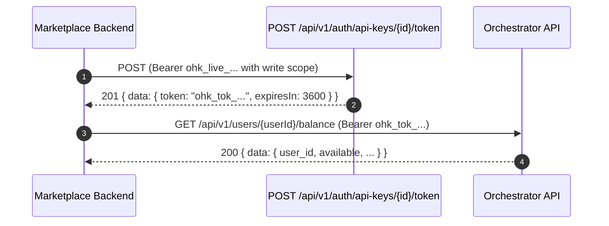

The OFFER-HUB Orchestrator exposes a RESTful JSON API. All endpoints are prefixed with `/api/v1`.

This reference is written for teams running the OFFER-HUB Orchestrator for their own marketplace: the public Orchestrator repository serves as the starter shell.

## Base URL

```
https://{your-orchestrator-domain}/api/v1
```

For local development:

```
http://localhost:4000/api/v1
```

## Authentication and Credentials

The API enforces two distinct kinds of credentials:

| Credential Kind | Lifespan | Format | Issued via | Used for |
| --- | --- | --- | --- | --- |
| **API Key Token** | 1 hour | `ohk_tok_...` | Exchanged from `ohk_live_...` with scopes `read`, `write`, or `support` via `POST /api/v1/auth/api-keys/{id}/token` | Server-to-server operations: marketplace user creation (`POST /users`), balance operations (`/balance/*`), withdrawals history (`/withdrawals`), events stream (`GET /events`), API-key management, and `GET /auth/me`. |
| **User Session JWT** | 7 days | Standard Bearer JWT | User registration/login or wallet challenge/verification (`POST /auth/wallet/verify`) | User-authenticated business operations: orders, smart contract escrow, resolution, disputes, wallet management, BlindPay bank accounts, KYC, and payouts. |

Public routes require no authentication: end-user registration and sign-in (`/auth/register`, `/auth/login`, `/auth/wallet/challenge`, `/auth/wallet/verify`, `/auth/forgot-password`, `/auth/reset-password`, `/auth/verify-email`, `/auth/oauth/callback`, `/auth/oauth/check-email`), platform configuration (`GET /config`), and basic health check (`GET /health`).

Send the credential in the standard `Authorization` header:

```http
Authorization: Bearer <token>
```

### Token Exchange Flow

A marketplace backend stores its long-lived API key (`ohk_live_...`) securely in environment variables. To interact with business endpoints, it exchanges this key for a 1-hour token using `POST /auth/api-keys/{id}/token` with the `write` scope:



## Resource Identifiers (IDs)

Resource identifiers in OFFER-HUB are formatted as an entity prefix followed by 32 random alphanumeric characters (not standard UUIDs):

| Prefix | Resource | Example Format |
| --- | --- | --- |
| `usr_` | User | `usr_9f2c1a7e5b3d8f6041c2a9e7b5d3f1a0` |
| `ord_` | Order | `ord_1a2b3c4d5e6f7a8b9c0d1e2f3a4b5c6d` |
| `esc_` | Escrow Contract | `esc_8a7b6c5d4e3f2a1b0c9d8e7f6a5b4c3d` |
| `dsp_` | Dispute | `dsp_1f2e3d4c5b6a708990a1b2c3d4e5f6a7` |
| `wd_` | Withdrawal | `wd_2b3c4d5e6f7a8b9c0d1e2f3a4b5c6d7e` |
| `evt_` | Domain Event | `evt_102030405060708090a0b0c0d0e0f010` |
| `wal_` | Stellar Wallet | `wal_4b5c6d7e8f9a0b1c2d3e4f5a6b7c8d9e` |
| `ba_` | Bank Account | `ba_7c8d9e0f1a2b3c4d5e6f7a8b9c0d1e2f` |
| `pay_` | Bank Payout | `pay_3d4e5f6a7b8c9d0e1f2a3b4c5d6e7f8a` |
| `kyc_` | KYC Receiver | `kyc_5e6f7a8b9c0d1e2f3a4b5c6d7e8f9a0b` |
| `key_` | API Key | `key_0a1b2c3d4e5f6a7b8c9d0e1f2a3b4c5d` |
| `mkt_` | Marketplace | `mkt_1a2b3c4d5e6f7a8b9c0d1e2f3a4b5c6d` |

## Common Headers

### Request Headers

| Header | Required | Description |
| --- | --- | --- |
| `Authorization` | Yes (for protected endpoints) | `Bearer {token}` (either `ohk_tok_...` or user session JWT) |
| `Content-Type` | Yes (for POST, PUT, PATCH with body) | `application/json` |
| `Idempotency-Key` | **Required** on mutating payments | Required on `POST /orders`, `POST /orders/:id/escrow/submit`, and `POST /orders/:orderId/payout/submit`. Optional on other mutating routes. |
| `X-Request-ID` | No | Client correlation identifier (echoed in response). |

### Response Headers

| Header | Description |
| --- | --- |
| `X-Request-ID` | Correlation ID generated or echoed by server. |
| `Idempotency-Replay` | `true` when response is served from cached execution of the same idempotency key. |
| `X-RateLimit-Limit` | Request limit per minute (`100`). |
| `X-RateLimit-Remaining` | Remaining allowed requests in window. |
| `X-RateLimit-Reset` | Unix timestamp of rate limit bucket reset. |

## Response Format and Envelopes

Every JSON response follows a consistent envelope format:

- **Success Responses:** Wrapped in `{ "data": ..., "meta"?: { "requestId", "timestamp" } }`.
- **Error Responses:** Standardized as `{ "error": { "code", "message", "details"? } }`.

### Success Envelope Example

```json
{
  "data": {
    "success": true,
    "data": {
      "id": "ord_1a2b3c4d5e6f7a8b9c0d1e2f3a4b5c6d",
      "status": "ORDER_CREATED",
      "buyerId": "usr_9f2c1a7e5b3d8f6041c2a9e7b5d3f1a0",
      "sellerId": "usr_7b8c9d0e1f2a3b4c5d6e7f8a9b0c1d2e",
      "amount": "2500.00",
      "currency": "USDC"
    }
  },
  "meta": {
    "requestId": "req_9f2c1a7e5b3d8f6041c2a9e7b5d3f1a0",
    "timestamp": "2026-02-18T10:00:00.000Z"
  }
}
```

### Error Envelope Example

```json
{
  "error": {
    "code": "INSUFFICIENT_FUNDS",
    "message": "Available balance is less than requested reservation amount",
    "details": {
      "available": "1250.00",
      "requested": "2500.00",
      "currency": "USDC"
    }
  }
}
```

## Idempotency Rules and Replay Behavior

The `Idempotency-Key` header prevents duplicate execution caused by network timeouts, retries, or double submission.

### Mandatory Endpoints

The `Idempotency-Key` header is **mandatory** on three critical financial mutation endpoints:

1. `POST /api/v1/orders` (Order creation)
2. `POST /api/v1/orders/:id/escrow/submit` (Smart contract escrow submission)
3. `POST /api/v1/orders/:orderId/payout/submit` (Bank payout off-ramp submission)

### Replay Semantics

1. **First request:** The mutation executes, and the resulting HTTP status and response payload are cached in Redis for 24 hours.
2. **Replay (identical key and body):** The server intercepts the request and replays the cached response immediately, adding the header `Idempotency-Replay: true`.
3. **Payload mismatch (same key, different body):** The server rejects the mutation with `409 IDEMPOTENCY_KEY_REUSED`.
4. **Concurrent execution:** A second request arriving while the first is still processing is rejected with `409 IDEMPOTENCY_KEY_IN_PROGRESS`.

```http
POST /api/v1/orders
Authorization: Bearer <session-jwt>
Idempotency-Key: 550e8400-e29b-41d4-a716-446655440000
Content-Type: application/json

{
  "buyerId": "usr_9f2c1a7e5b3d8f6041c2a9e7b5d3f1a0",
  "sellerId": "usr_7b8c9d0e1f2a3b4c5d6e7f8a9b0c1d2e",
  "amount": "2500.00",
  "currency": "USDC"
}
```

## Non-Custodial Signing Architecture

OFFER-HUB is strictly non-custodial. The server never holds user private keys and never signs on behalf of users:

- Supported wallets: Freighter (now branded **Varial**), **Lobstr**, and **xBull** connected via **Stellar Wallets Kit**.
- **Prepare, sign, submit pattern:**
  1. The client calls a `prepare` endpoint (e.g. `POST /orders/:id/escrow/fund/prepare`).
  2. The Orchestrator returns an unsigned transaction XDR.
  3. The user signs the XDR client-side in their wallet.
  4. The client submits the signed XDR via the matching `submit` endpoint (e.g. `POST /orders/:id/escrow/submit`).
- Testnet sandbox feature: Custodial "invisible" wallets and the 90-day "Claim your wallet" flow (`POST /wallet/claim`) exist only in the testnet sandbox. Production mainnet uses user-owned wallets exclusively.

## Order and Escrow State Machine

Orders follow an exact 13-state lifecycle. **There is no CANCELLED status**:

```
ORDER_CREATED -> FUNDS_RESERVED -> ESCROW_CREATING -> ESCROW_FUNDING -> ESCROW_FUNDED -> IN_PROGRESS -> DELIVERED -> RELEASE_REQUESTED -> RELEASED -> CLOSED
```

- **Cancellation:** Calling `POST /api/v1/orders/:id/cancel` is only permitted while the order is in `ORDER_CREATED` or `FUNDS_RESERVED` status. It immediately transitions the order to **`CLOSED`** and releases any reserved balance back to the buyer.
- **Refund Path:** If an issue arises after escrow funding, `REFUND_REQUESTED` -> `REFUNDED` -> `CLOSED`.
- **Disputes:** Opened by `BUYER` or `SELLER` with reasons `NOT_DELIVERED`, `QUALITY_ISSUE`, or `OTHER`. Dispute statuses: `OPEN` -> `UNDER_REVIEW` -> `RESOLVED`. Outcomes: `FULL_RELEASE`, `FULL_REFUND`, or `SPLIT`.

## Fiat Off-Ramp (BlindPay)

Sellers receive payouts via **BlindPay** into their local bank accounts in exactly 4 supported LATAM corridors:

- **Brazil (BR):** Payouts in Brazilian Real (BRL)
- **Mexico (MX):** Payouts in Mexican Peso (MXN)
- **Argentina (AR):** Payouts in Argentine Peso (ARS)
- **Colombia (CO):** Payouts in Colombian Peso (COP)

Bank-account payout quotes require a **minimum of 5.00 USD** (or rail-specific threshold). Receiver accounts are subject to transaction volume limits, which can be upgraded through BlindPay's compliance process. Operator fees are governed by the marketplace operator's BlindPay commercial agreement.

## Stellar Network and RPC

- **Mainnet:** Live production deployment using Trustless Work Soroban contracts and USDC token contracts.
- **Testnet:** Public development sandbox with test tokens and faucet funding.
- **Stellar RPC:** All blockchain communication is performed via modern Stellar RPC endpoints. (Horizon was retired).

## Rate Limiting

The API applies a standard rate limit of 100 requests per 60 seconds per credential (or client IP for unauthenticated public requests). When exceeded, the server returns `429 RATE_LIMITED`.

## Available Endpoints

The endpoints below represent the complete public contract of the OFFER-HUB Orchestrator:

### Auth and Credentials

| Method | Path | Auth | Description |
| --- | --- | --- | --- |
| <Badge variant="primary">POST</Badge> | `/api/v1/auth/api-keys` | `apiKeyAuth` (support) | Create long-lived API key |
| <Badge variant="success">GET</Badge> | `/api/v1/auth/api-keys` | `apiKeyAuth` (support) | List active API keys |
| <Badge variant="primary">POST</Badge> | `/api/v1/auth/api-keys/{id}/token` | `apiKeyAuth` (write) | Exchange API key for 1-hour token |
| <Badge variant="success">GET</Badge> | `/api/v1/auth/me` | `apiKeyAuth` | Inspect authenticated credential context |
| <Badge variant="primary">POST</Badge> | `/api/v1/auth/register` | None (public) | Register user with email and password |
| <Badge variant="primary">POST</Badge> | `/api/v1/auth/login` | None (public) | User email and password login |
| <Badge variant="primary">POST</Badge> | `/api/v1/auth/forgot-password` | None (public) | Request password reset email |
| <Badge variant="primary">POST</Badge> | `/api/v1/auth/reset-password` | None (public) | Complete password reset |
| <Badge variant="success">GET</Badge> | `/api/v1/auth/verify-email` | None (public) | Verify email address |
| <Badge variant="primary">POST</Badge> | `/api/v1/auth/wallet/challenge` | None (public) | Request Stellar wallet auth challenge |
| <Badge variant="primary">POST</Badge> | `/api/v1/auth/wallet/verify` | None (public) | Verify challenge signature for session JWT |
| <Badge variant="primary">POST</Badge> | `/api/v1/auth/oauth/callback` | None (public) | Exchange OAuth code for session JWT |
| <Badge variant="success">GET</Badge> | `/api/v1/auth/oauth/check-email` | None (public) | Check if email is registered with OAuth |
| <Badge variant="primary">POST</Badge> | `/api/v1/auth/send-verification` | `userSessionAuth` | Send email verification link |
| <Badge variant="primary">POST</Badge> | `/api/v1/auth/change-password` | `userSessionAuth` | Update account password |
| <Badge variant="success">GET</Badge> | `/api/v1/auth/sessions` | `userSessionAuth` | List active user sessions |
| <Badge variant="danger">DELETE</Badge> | `/api/v1/auth/sessions/{id}` | `userSessionAuth` | Revoke a specific session |
| <Badge variant="danger">DELETE</Badge> | `/api/v1/auth/sessions` | `userSessionAuth` | Revoke all other active sessions |
| <Badge variant="primary">POST</Badge> | `/api/v1/auth/oauth/link` | `userSessionAuth` | Link OAuth account |
| <Badge variant="danger">DELETE</Badge> | `/api/v1/auth/oauth/link/{provider}` | `userSessionAuth` | Unlink OAuth provider |
| <Badge variant="success">GET</Badge> | `/api/v1/auth/oauth/linked-accounts` | `userSessionAuth` | List linked OAuth providers |

### Users

| Method | Path | Auth | Description |
| --- | --- | --- | --- |
| <Badge variant="primary">POST</Badge> | `/api/v1/users` | `apiKeyAuth` (write) | Create marketplace user and ledger balance |

### Wallet

| Method | Path | Auth | Description |
| --- | --- | --- | --- |
| <Badge variant="success">GET</Badge> | `/api/v1/wallet` | `userSessionAuth` | Get primary wallet and trustline status |
| <Badge variant="success">GET</Badge> | `/api/v1/wallet/readiness` | `userSessionAuth` | Verify wallet readiness for transactions |
| <Badge variant="success">GET</Badge> | `/api/v1/wallet/wallets` | `userSessionAuth` | List connected Stellar wallets |
| <Badge variant="success">GET</Badge> | `/api/v1/wallet/dashboard` | `userSessionAuth` | Wallet dashboard overview and balance |
| <Badge variant="success">GET</Badge> | `/api/v1/wallet/transactions` | `userSessionAuth` | List on-chain transaction history |
| <Badge variant="primary">POST</Badge> | `/api/v1/wallet/connect` | `userSessionAuth` | Connect external wallet (Freighter, Lobstr, xBull) |
| <Badge variant="primary">POST</Badge> | `/api/v1/wallet/disconnect` | `userSessionAuth` | Disconnect wallet |
| <Badge variant="primary">POST</Badge> | `/api/v1/wallet/reconnect` | `userSessionAuth` | Reconnect wallet |
| <Badge variant="primary">POST</Badge> | `/api/v1/wallet/set-primary` | `userSessionAuth` | Set wallet as primary for payouts |
| <Badge variant="primary">POST</Badge> | `/api/v1/wallet/claim` | `userSessionAuth` | Claim invisible wallet (sandbox only) |

### Orders

| Method | Path | Auth | Description |
| --- | --- | --- | --- |
| <Badge variant="primary">POST</Badge> | `/api/v1/orders` | `userSessionAuth` | Create order (**Idempotency-Key required**) |
| <Badge variant="success">GET</Badge> | `/api/v1/orders` | `userSessionAuth` | List orders |
| <Badge variant="success">GET</Badge> | `/api/v1/orders/my-purchases` | `userSessionAuth` | List orders where caller is buyer |
| <Badge variant="success">GET</Badge> | `/api/v1/orders/{id}` | `userSessionAuth` | Get order details by ID |
| <Badge variant="primary">POST</Badge> | `/api/v1/orders/{id}/reserve` | `userSessionAuth` | Reserve order amount in ledger |
| <Badge variant="primary">POST</Badge> | `/api/v1/orders/{id}/cancel` | `userSessionAuth` | Cancel order (moves to `CLOSED`) |
| <Badge variant="success">GET</Badge> | `/api/v1/orders/{id}/milestones` | `userSessionAuth` | List order milestones |
| <Badge variant="primary">POST</Badge> | `/api/v1/orders/{id}/milestones/{milestoneRef}/complete` | `userSessionAuth` | Complete milestone |
| <Badge variant="primary">POST</Badge> | `/api/v1/orders/{id}/complete` | `userSessionAuth` | Mark order deliverables complete |
| <Badge variant="primary">POST</Badge> | `/api/v1/orders/{id}/attachments` | `userSessionAuth` | Add attachment to order |
| <Badge variant="danger">DELETE</Badge> | `/api/v1/orders/{id}/attachments/{attachmentId}` | `userSessionAuth` | Delete attachment |
| <Badge variant="primary">POST</Badge> | `/api/v1/orders/{id}/notes` | `userSessionAuth` | Add internal order note |

### Escrow

| Method | Path | Auth | Description |
| --- | --- | --- | --- |
| <Badge variant="primary">POST</Badge> | `/api/v1/orders/{id}/escrow/prepare` | `userSessionAuth` | Prepare unsigned escrow contract transaction |
| <Badge variant="primary">POST</Badge> | `/api/v1/orders/{id}/escrow/fund/prepare` | `userSessionAuth` | Prepare unsigned escrow funding transaction |
| <Badge variant="primary">POST</Badge> | `/api/v1/orders/{id}/escrow/submit` | `userSessionAuth` | Submit signed escrow transaction (**Idempotency-Key required**) |

### Resolution

| Method | Path | Auth | Description |
| --- | --- | --- | --- |
| <Badge variant="primary">POST</Badge> | `/api/v1/orders/{orderId}/resolution/release/prepare` | `userSessionAuth` | Prepare unsigned release transaction |
| <Badge variant="primary">POST</Badge> | `/api/v1/orders/{orderId}/resolution/refund/prepare` | `userSessionAuth` | Prepare unsigned refund transaction |
| <Badge variant="primary">POST</Badge> | `/api/v1/orders/{orderId}/resolution/dispute/prepare` | `userSessionAuth` | Prepare unsigned dispute transaction |
| <Badge variant="primary">POST</Badge> | `/api/v1/orders/{orderId}/resolution/dispute` | `userSessionAuth` | Open dispute on active order |

### Disputes

| Method | Path | Auth | Description |
| --- | --- | --- | --- |
| <Badge variant="success">GET</Badge> | `/api/v1/disputes` | `userSessionAuth` | List user disputes |
| <Badge variant="success">GET</Badge> | `/api/v1/disputes/{id}` | `userSessionAuth` | Get dispute details |
| <Badge variant="primary">POST</Badge> | `/api/v1/disputes/{id}/cancel` | `userSessionAuth` | Cancel opened dispute |

### KYC

| Method | Path | Auth | Description |
| --- | --- | --- | --- |
| <Badge variant="success">GET</Badge> | `/api/v1/users/me/kyc` | `userSessionAuth` | Get KYC verification status |
| <Badge variant="primary">POST</Badge> | `/api/v1/users/me/kyc` | `userSessionAuth` | Submit KYC onboarding |
| <Badge variant="primary">POST</Badge> | `/api/v1/users/me/kyc/tos-url` | `userSessionAuth` | Get BlindPay ToS acceptance URL |
| <Badge variant="primary">POST</Badge> | `/api/v1/users/me/kyc/tos-accept` | `userSessionAuth` | Record ToS acceptance |

### Bank Accounts

| Method | Path | Auth | Description |
| --- | --- | --- | --- |
| <Badge variant="success">GET</Badge> | `/api/v1/users/me/bank-accounts` | `userSessionAuth` | List bank accounts for off-ramps |
| <Badge variant="primary">POST</Badge> | `/api/v1/users/me/bank-accounts` | `userSessionAuth` | Add bank account (BR, MX, AR, CO) |
| <Badge variant="primary">PATCH</Badge> | `/api/v1/users/me/bank-accounts/{id}/default` | `userSessionAuth` | Set default bank account |
| <Badge variant="danger">DELETE</Badge> | `/api/v1/users/me/bank-accounts/{id}` | `userSessionAuth` | Delete bank account |

### Payouts

| Method | Path | Auth | Description |
| --- | --- | --- | --- |
| <Badge variant="success">GET</Badge> | `/api/v1/orders/{id}/payout` | `userSessionAuth` | Get payout status for order |
| <Badge variant="primary">POST</Badge> | `/api/v1/orders/{orderId}/payout/prepare` | `userSessionAuth` | Prepare unsigned bank payout transaction |
| <Badge variant="primary">POST</Badge> | `/api/v1/orders/{orderId}/payout/submit` | `userSessionAuth` | Submit signed payout (**Idempotency-Key required**) |
| <Badge variant="primary">POST</Badge> | `/api/v1/orders/{orderId}/payout/retry` | `userSessionAuth` | Retry failed payout |

### Withdrawals

| Method | Path | Auth | Description |
| --- | --- | --- | --- |
| <Badge variant="success">GET</Badge> | `/api/v1/withdrawals` | `apiKeyAuth` (read) | List historical withdrawals |
| <Badge variant="success">GET</Badge> | `/api/v1/withdrawals/{id}` | `apiKeyAuth` (read) | Get withdrawal details |

### Balance

All balance endpoints are scoped to a user: `/users/{userId}/balance`. See [Balance Endpoints](/docs/api-reference/balance) for exact DTOs, response envelopes, errors, and tabbed examples.

| Method | Path | Auth | Description |
| --- | --- | --- | --- |
| <Badge variant="success">GET</Badge> | `/api/v1/users/{userId}/balance` | `apiKeyAuth` (read) | Get user balance |
| <Badge variant="primary">POST</Badge> | `/api/v1/users/{userId}/balance/credit` | `apiKeyAuth` (write) | Credit available balance |
| <Badge variant="primary">POST</Badge> | `/api/v1/users/{userId}/balance/debit` | `apiKeyAuth` (write) | Debit available balance |
| <Badge variant="primary">POST</Badge> | `/api/v1/users/{userId}/balance/reserve` | `apiKeyAuth` (write) | Reserve funds for order |
| <Badge variant="primary">POST</Badge> | `/api/v1/users/{userId}/balance/release` | `apiKeyAuth` (write) | Release reserved balance to seller |
| <Badge variant="primary">POST</Badge> | `/api/v1/users/{userId}/balance/cancel-reservation` | `apiKeyAuth` (write) | Cancel reservation |
| <Badge variant="primary">POST</Badge> | `/api/v1/users/{userId}/balance/deduct-reserved` | `apiKeyAuth` (write) | Deduct from reserved balance |
| <Badge variant="primary">POST</Badge> | `/api/v1/users/{userId}/balance/sync` | `apiKeyAuth` (write) | Sync balance with provider |
| <Badge variant="success">GET</Badge> | `/api/v1/users/{userId}/balance/verify` | `apiKeyAuth` (read) | Verify balance with provider |
| <Badge variant="primary">POST</Badge> | `/api/v1/users/{userId}/balance/reconcile` | `apiKeyAuth` (write) | Reconcile balance discrepancy |

### Config and Health

| Method | Path | Auth | Description |
| --- | --- | --- | --- |
| <Badge variant="success">GET</Badge> | `/api/v1/config` | None (public) | Platform configuration |
| <Badge variant="success">GET</Badge> | `/api/v1/health` | None (public) | Basic health check |

### Events

| Method | Path | Auth | Description |
| --- | --- | --- | --- |
| <Badge variant="success">GET</Badge> | `/api/v1/events` | `apiKeyAuth` (read) | Subscribe to real-time SSE stream |

## Next Steps

- [Error Codes Reference](/docs/api-reference/errors) - Complete error catalog and SDK mapping
- [Events Stream Reference](/docs/api-reference/events) - Server-Sent Events domain catalog
- [Config and Health](/docs/api-reference/config-and-health) - Platform limits and liveness probes
- [Interactive API Explorer](/docs/api-reference/interactive) - Test API requests in real time
