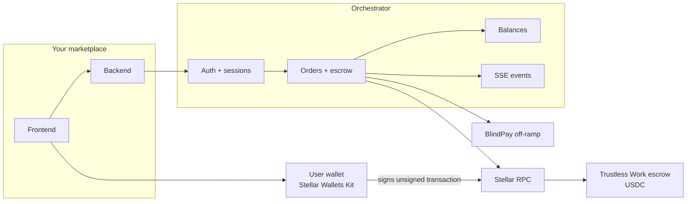

The OFFER-HUB Orchestrator is a **non-custodial escrow and payments backend for marketplaces**, built on Stellar. Your marketplace keeps its own users, listings, messaging and interface; the Orchestrator handles checkout, escrow, balances, disputes and payouts.

It is built for teams that want escrow-protected payments without becoming a payments company — and without taking custody of anyone's funds.

<Callout type="tip">
  **Building your own marketplace?** Start with the [Build Your First Marketplace](/docs/guide/build-your-first-marketplace) tutorial. It walks from a running instance to a completed escrow in one sitting.
</Callout>

## What exists today

| Area | What it does |
|---|---|
| **Network** | Mainnet is live. A public testnet sandbox is available for development. |
| **Escrow** | Trustless Work Soroban escrows in USDC. Funds are held by the contract, not by the Orchestrator. |
| **Signing** | The Orchestrator prepares unsigned Stellar transactions. Users sign with their own wallet through Stellar Wallets Kit (Freighter/Varial, Lobstr, xBull). The server never signs for a user. |
| **Connectivity** | Stellar RPC, with the network selected by the operator. |
| **Off-ramp** | BlindPay payouts to four corridors: Brazil, Mexico, Argentina and Colombia. |
| **Authentication** | API keys for your backend, plus user sessions from wallet or email sign-in. |
| **Orders** | A single state machine from creation to close, including funding, delivery, release, refund and disputes. |
| **Disputes** | Opened by buyer or seller, reviewed, then resolved by full release, full refund or split. |
| **Real time** | An authenticated SSE stream for order, balance and dispute events. |

## How the pieces fit



Two rules shape the whole design:

1. **Your backend holds an API key; your users hold their keys.** The Orchestrator never stores a mainnet user's private key and never signs on their behalf.
2. **Escrow is on-chain.** Once an order is funded, neither party — and not the Orchestrator — can move the funds outside the contract's rules.

## Authentication in one minute

The Orchestrator accepts two credential kinds:

| Credential | Who uses it | Lifetime |
|---|---|---|
| API key `ohk_live_...` | Your marketplace backend | Until revoked |
| Scoped token `ohk_tok_...` | Your frontend, after exchanging an API key | 1 hour |
| User session JWT | A signed-in buyer or seller | 7 days |

API keys carry `read`, `write` or `support` scopes. User JWTs come from either wallet sign-in or email/password sign-in and are the same JWT in both cases.

<Callout type="warning">
  Never ship an API key to the browser. Exchange it for a one-hour token server-side, or create the user session on your backend.
</Callout>

## Bootstrapping a self-hosted instance

The operator sets a master key once, uses it to create the first API key with `support` scope, then creates `read` and `write` keys for the marketplace backend:

```env
OFFERHUB_MASTER_KEY=your-master-key
```

```bash
curl -X POST http://localhost:4000/api/v1/auth/api-keys \
  -H "Authorization: Bearer your-master-key" \
  -H "Content-Type: application/json" \
  -d '{"name": "Operator", "scopes": ["support"]}'
```

The full sequence is documented in [Installation](/docs/installation#creating-your-first-api-key).

## The starter shell

The public Orchestrator repository, [github.com/OFFER-HUB/OFFER-HUB](https://github.com/OFFER-HUB/OFFER-HUB), is the starter shell: the base a team clones to build its own marketplace on top of the Orchestrator. It shows how the API, database and providers are wired; adapt it to your product rather than treating it as the full source of the hosted service.

## Where to go next

- [Installation](/docs/installation) — installer, manual setup, or SDK only.
- [Configuration](/docs/configuration) — environment variables for self-hosting.
- [Self-Hosting](/docs/guide/self-hosting) — production deployment and upgrades.
- [Build Your First Marketplace](/docs/guide/build-your-first-marketplace) — end-to-end tutorial.
- [Orchestrator](/docs/guide/orchestrator) — how the payment engine works.
- [Architecture](/docs/guide/architecture) — trust boundaries and isolation.
- [SDK Quick Start](/docs/sdk/quick-start) — the TypeScript client.
- [API Reference](/docs/api-reference/overview) — endpoints and envelopes.

<Callout type="note">
  Need help? Open an issue on [GitHub](https://github.com/OFFER-HUB/offer-hub-monorepo/issues) or join the [Discord community](https://discord.gg/offerhub).
</Callout>
