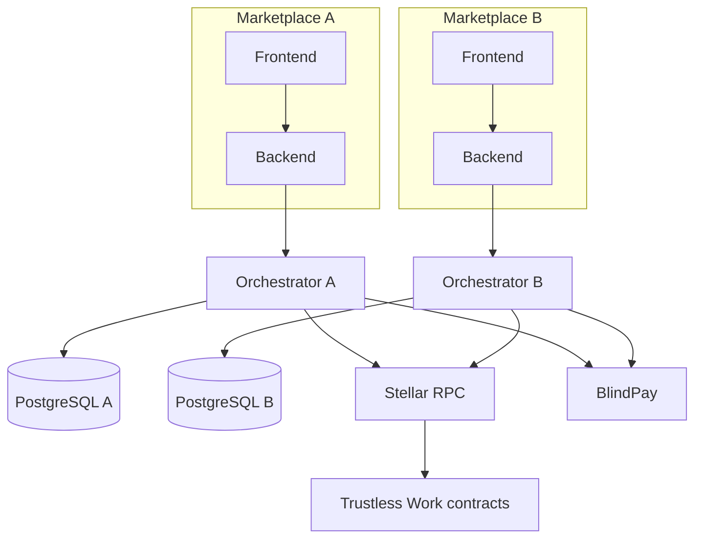

OFFER-HUB is **not a shared SaaS**. Each marketplace runs its own Orchestrator instance, with its own database, credentials and provider configuration.

## Principles

<Callout type="warning">
  These principles are not optional. Every design decision below follows from them.
</Callout>

- **Self-hosting is supported and expected.** Your instance, your data.
- **Funds belong to users.** The Orchestrator keeps a ledger; it does not take custody.
- **Escrow is non-custodial.** USDC sits in a Trustless Work Soroban contract, not in an Orchestrator wallet.
- **Users sign for themselves.** The Orchestrator prepares unsigned transactions; the wallet signs them.
- **Idempotency and correlation are required** on money-moving requests.
- **Secrets stay server-side.** Only `NEXT_PUBLIC_*` values may reach a browser.

## System overview

For a visual map of the services inside one instance, see the [Orchestrator guide](/docs/guide/orchestrator#end-to-end-flow).

## Trust boundaries

| Boundary | Who trusts whom | Consequence |
|---|---|---|
| Marketplace backend → Orchestrator | The Orchestrator trusts an API key with the right scope | A leaked `write` key can move orders; keep it server-side |
| Browser → Orchestrator | The Orchestrator trusts a one-hour token, not an API key | Tokens limit the blast radius of a frontend compromise |
| User wallet → Stellar | The network trusts a signature from the user's key | The Orchestrator cannot sign for a user or move escrowed funds alone |
| Orchestrator → Trustless Work | The Orchestrator trusts the contract's state as reported over RPC | Always confirm an escrow is funded before you act on it |
| Orchestrator → BlindPay | The Orchestrator trusts BlindPay payout status for fiat rails | Reconcile payouts; do not treat a UI state as settlement |

## Authentication model

Three credentials, three jobs:

| Credential | Lifetime | Used by | Capability |
|---|---|---|---|
| API key `ohk_live_...` | Until revoked | Marketplace backend | Scopes: `read`, `write`, `support` |
| Token `ohk_tok_...` | 1 hour | Browser code | Exchanged from an API key; narrow, short-lived |
| User session JWT | 7 days | Your app for the signed-in user | Wallet or email sign-in; identical JWT either way |

The operator bootstrap is separate: `OFFERHUB_MASTER_KEY` creates the first API key, which is then used to issue scoped keys. After bootstrap the master key should not be used by application traffic.

## Data model

The Orchestrator stores users, balances, orders, escrows, milestones, disputes, payouts and audit records in PostgreSQL. Redis holds job queues, idempotency records and rate-limit counters.

Key invariants:

- Balance changes go through the ledger service, never through ad-hoc SQL.
- An order has at most one escrow.
- An order in `DISPUTED` cannot be released until resolution.
- Idempotency records are scoped to the marketplace and the request body.

## Events

`GET /api/v1/events` streams order, balance, escrow, dispute, payout and withdrawal events over SSE, authenticated with your credential. Events are notifications, not proof: re-read the resource before you act on money.

Inbound webhooks are a different direction. The Orchestrator receives provider callbacks (for example from Trustless Work) to keep escrow state current. There is no outbound webhook subscription API.

## Isolation

- Each marketplace has its own instance, database and credentials.
- API keys are scoped to their instance.
- Provider credentials belong to the operator, not to end users.
- Sandbox-only features, such as invisible wallets and the 90-day wallet claim flow, never appear on a mainnet deployment.

## Next steps

- [Orchestrator](/docs/guide/orchestrator) — engine internals
- [Self-Hosting](/docs/guide/self-hosting) — deployment topology
- [Security Best Practices](/docs/guide/security) — integration hardening
