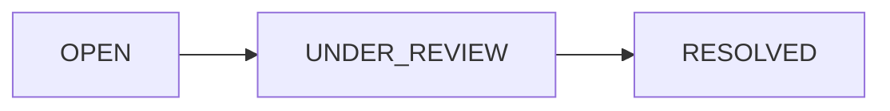

import { Callout } from '@/components/callout'

## Overview

Either the **BUYER** or the **SELLER** can open a dispute when a problem arises with an order. Disputes trigger a platform review and determine how the escrowed USDC is distributed.

<Callout type="info">
  A dispute can only be opened when the order is in `IN_PROGRESS` or `DELIVERED`.
</Callout>

## Dispute Reasons

| Reason | When to Use |
|---|---|
| `NOT_DELIVERED` | The seller did not deliver within the agreed timeframe. |
| `QUALITY_ISSUE` | The delivery does not meet the agreed quality standard. |
| `OTHER` | Any other reason not covered above. |

## Dispute Status Flow

Disputes move through three statuses:

| Status | Meaning |
|---|---|
| `OPEN` | The dispute has been filed and is awaiting review. |
| `UNDER_REVIEW` | The platform team is actively reviewing the case. |
| `RESOLVED` | The platform has issued a resolution outcome. |

## Resolution Outcomes

| Outcome | Effect |
|---|---|
| `FULL_RELEASE` | The full escrowed amount is released to the seller. |
| `FULL_REFUND` | The full escrowed amount is returned to the buyer. |
| `SPLIT` | The escrowed amount is divided between buyer and seller per the platform decision. |

Outcomes are decided by platform review. Participants cannot set outcomes directly.

## Participant Endpoints

These endpoints are available to buyers and sellers:

| Method | Path | Description |
|---|---|---|
| `GET` | `/disputes` | List all disputes for the authenticated user. |
| `GET` | `/disputes/:id` | Retrieve a single dispute by ID. |
| `POST` | `/disputes/:id/cancel` | Cancel an open dispute (only while status is `OPEN`). |

> Admin and internal resolution endpoints are not documented here.
