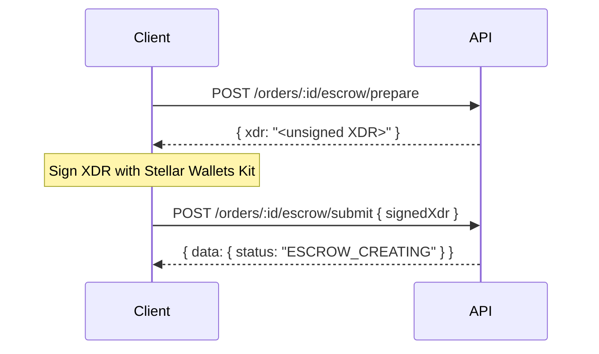
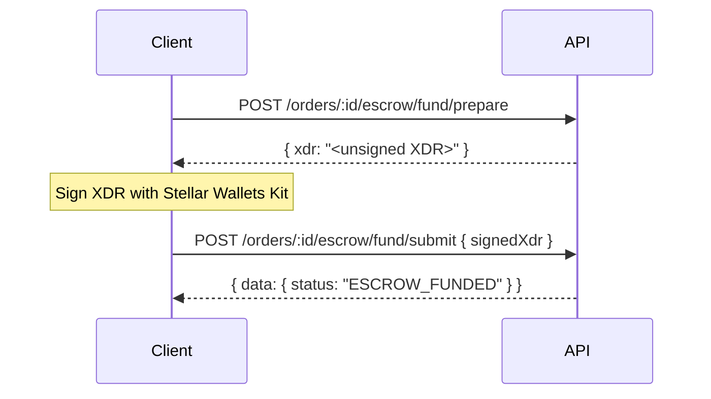
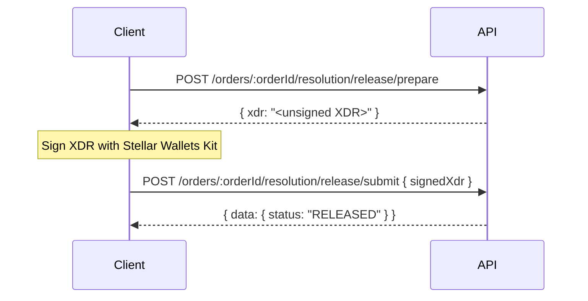
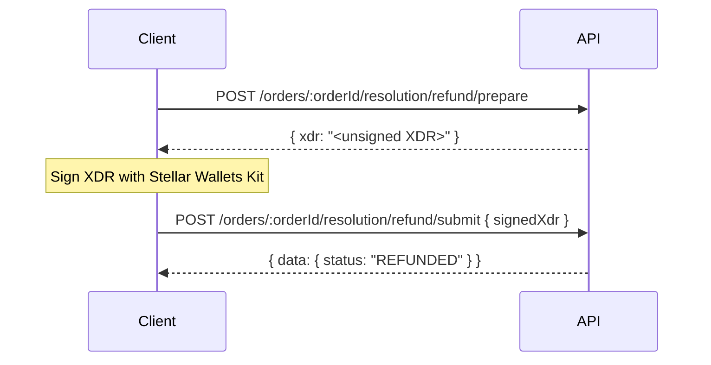
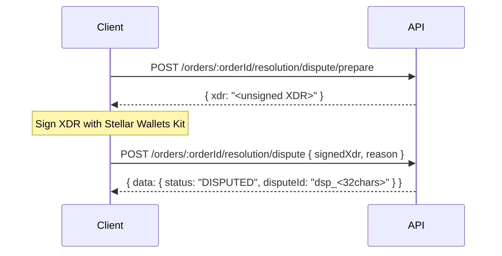

<Callout type="warning">
  The server never signs on behalf of the user. Every on-chain transaction must be signed client-side before submission.
</Callout>

## 1. Create Escrow

The client prepares, signs, and submits the escrow creation transaction.

## 2. Fund Escrow

Once the contract is deployed, the buyer funds it with USDC.

## 3. Release Funds

The buyer approves delivery and releases funds to the seller.

## 4. Refund

Either party requests a refund; the USDC is returned to the buyer.

## 5. Dispute

Either party opens a dispute. The prepare/sign flow stages the on-chain transaction; the final POST opens the dispute record.

