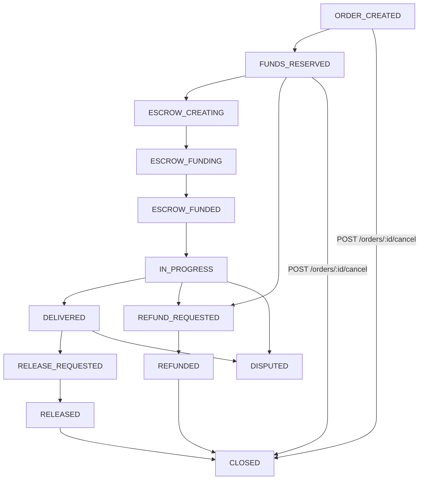

---
title: Order State Machine
description: Complete order lifecycle — statuses, transitions and the cancel rule.
order: 16
section: Guides
---

## Order Lifecycle

Every order moves through a fixed set of statuses. The diagram below shows all valid transitions, including the escrow creation path, the refund path, the dispute path, and the cancel shortcut.

<Callout type="warning">
  There is no `CANCELLED` status. `POST /orders/:id/cancel` moves the order directly to `CLOSED`.
</Callout>

## Status Reference

| Status | Triggered By | Next States |
|---|---|---|
| `ORDER_CREATED` | Buyer calls `POST /orders` | `FUNDS_RESERVED`, `CLOSED` (cancel) |
| `FUNDS_RESERVED` | Payment provider reserves buyer funds | `ESCROW_CREATING`, `REFUND_REQUESTED`, `CLOSED` (cancel) |
| `ESCROW_CREATING` | Orchestrator initiates escrow creation | `ESCROW_FUNDING` |
| `ESCROW_FUNDING` | Escrow contract created on-chain; funding in progress | `ESCROW_FUNDED` |
| `ESCROW_FUNDED` | USDC confirmed inside escrow contract | `IN_PROGRESS` |
| `IN_PROGRESS` | Platform unlocks work after escrow is funded | `DELIVERED`, `REFUND_REQUESTED`, `DISPUTED` |
| `DELIVERED` | Seller marks delivery | `RELEASE_REQUESTED`, `DISPUTED` |
| `RELEASE_REQUESTED` | Buyer approves delivery | `RELEASED` |
| `RELEASED` | Escrow release transaction submitted and confirmed | `CLOSED` |
| `CLOSED` | Terminal state — order settled, cancelled, or refunded | — |
| `REFUND_REQUESTED` | Buyer or seller requests refund | `REFUNDED` |
| `REFUNDED` | Escrow refund transaction confirmed | `CLOSED` |
| `DISPUTED` | Buyer or seller opens a dispute | Resolved externally → `CLOSED` |
