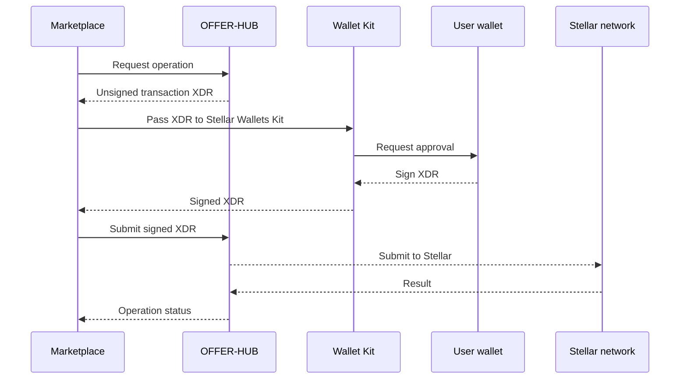

OFFER-HUB is an orchestration API for marketplaces. On mainnet, users connect their own Stellar wallet. The server prepares transactions, but the user signs client-side and submits the signed transaction.

## Supported wallets

Connect Stellar wallets through Stellar Wallets Kit:

- Freighter (now branded Varial)
- Lobstr
- xBull

## Credential required

Wallet resources require a signed-in user's 7-day JWT:

```http
Authorization: Bearer <user-session-jwt>
```

API-key credentials are for marketplace backend operations and creating/minting credentials. They are not a substitute for the user session JWT on wallet routes.

## Wallet endpoints

| Method | Path | Auth | Request fields | Response fields |
|---|---|---|---|---|
| `GET` | `/api/v1/wallet` | JWT | None | Wallet overview |
| `GET` | `/api/v1/wallet/readiness` | JWT | None | Readiness status and required setup |
| `GET` | `/api/v1/wallet/wallets` | JWT | None | Connected wallet list |
| `GET` | `/api/v1/wallet/dashboard` | JWT | None | Aggregated wallet/dashboard status |
| `GET` | `/api/v1/wallet/transactions` | JWT | Query fields supported by the SDK | Transaction list and pagination |
| `POST` | `/api/v1/wallet/connect` | JWT | SDK-published wallet connection fields | Connected wallet result |
| `POST` | `/api/v1/wallet/disconnect` | JWT | SDK-published wallet identity fields | Disconnect result |
| `POST` | `/api/v1/wallet/reconnect` | JWT | SDK-published wallet identity fields | Reconnected wallet result |
| `POST` | `/api/v1/wallet/set-primary` | JWT | SDK-published wallet identity fields | Primary-wallet result |
| `POST` | `/api/v1/wallet/claim` | JWT | Testnet sandbox only; SDK-published claim fields | Claim result |

<Callout type="warning">
The only platform signer is the server's platform key, used for platform-authorized operations. The Orchestrator never signs external-user transactions with a user private key.
</Callout>

## Wallet types

| Type | Use |
|---|---|
| `EXTERNAL` | User-owned wallet connected through Stellar Wallets Kit. This is the mainnet model. |
| `INVISIBLE` | Custodial wallet used only in the testnet sandbox. It is not a mainnet wallet model. |

## Testnet sandbox only

Invisible wallets existed only on testnet. On testnet, `POST /api/v1/wallet/claim` may let a sandbox user claim a wallet. A 90-day claim window applies to this sandbox feature.

These sandbox rules do not apply to mainnet:

- Mainnet uses `EXTERNAL`, user-owned wallets only.
- Mainnet has no sandbox invisible-wallet claim flow.
- Mainnet has no 90-day claim window.

## Signing flow

The server prepares unsigned transaction XDR. It does not sign for a user.



The platform signer is separate and signs only platform-authorized transactions with the platform key.

## Wallet sign-in

To authenticate a user with a wallet:

1. Call `POST /api/v1/auth/wallet/challenge` (public).
2. Present the returned message to the user.
3. Sign the message in Freighter/Varial, Lobstr, or xBull through Stellar Wallets Kit.
4. Call `POST /api/v1/auth/wallet/verify` (public).
5. Store the returned 7-day JWT and use it for wallet endpoints.

Email/password is an alternative sign-in method that creates the same session-JWT shape.

## SDK 3.0.0

```typescript
import { OfferHubSDK } from '@offerhub/sdk';

const sdk = new OfferHubSDK({
  apiUrl: process.env.OFFERHUB_API_URL!,
  apiKey: process.env.OFFERHUB_API_KEY!,
});

const userSdk = sdk.asUser(userSessionJwt);

const readiness = await userSdk.wallet.getReadiness();
const wallets = await userSdk.wallet.getWallets();
```

Use `sdk.auth.walletChallenge` and `sdk.auth.walletVerify` with Stellar Wallets Kit for wallet sign-in. The maintainer is publishing `@offerhub/sdk` 3.0.0; until then, use only SDK signatures confirmed in the issue thread rather than assuming method names or DTO fields.

## User types

Marketplace users may be:

- `BUYER`
- `SELLER`
- `BOTH`

## Related resources

- [Authentication & Credentials](/docs/api-reference/authentication)
- [Auth Endpoints](/docs/api-reference/auth)
- [SDK `wallet`](/docs/sdk/wallet)
