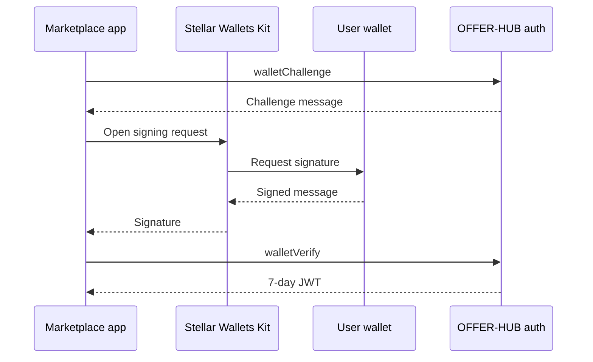
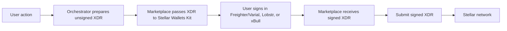

The `sdk.wallet` resource is used with a signed-in user session created by `sdk.asUser(token)`. Wallet operations require a 7-day JWT, not a marketplace API key.

<Callout type="note">
`@offerhub/sdk` 3.0.0 is in maintainer publishing. Until the package is live on npm, ask in the issue for a signature before relying on an SDK method or parameter that is not listed in this document.
</Callout>

## Create a user-session SDK

```typescript
import { OfferHubSDK } from '@offerhub/sdk';

const sdk = new OfferHubSDK({
  apiUrl: process.env.OFFERHUB_API_URL!,
  apiKey: process.env.OFFERHUB_API_KEY!,
});

const userSdk = sdk.asUser(userSessionJwt);
```

The API key initializes the marketplace SDK. `sdk.asUser(...)` binds the user-session JWT to wallet and other user resources.

## Supported wallet integrations

Use Stellar Wallets Kit in the marketplace frontend to connect:

- Freighter (now branded Varial)
- Lobstr
- xBull

The Orchestrator never stores a private key for an externally owned wallet.

## Resource map

| SDK resource/operation | HTTP method | HTTP path | Auth |
|---|---|---|---|
| Wallet overview | `GET` | `/api/v1/wallet` | JWT |
| Wallet readiness | `GET` | `/api/v1/wallet/readiness` | JWT |
| Connected wallets | `GET` | `/api/v1/wallet/wallets` | JWT |
| Wallet dashboard | `GET` | `/api/v1/wallet/dashboard` | JWT |
| Wallet transactions | `GET` | `/api/v1/wallet/transactions` | JWT |
| Connect wallet | `POST` | `/api/v1/wallet/connect` | JWT |
| Disconnect wallet | `POST` | `/api/v1/wallet/disconnect` | JWT |
| Reconnect wallet | `POST` | `/api/v1/wallet/reconnect` | JWT |
| Set primary wallet | `POST` | `/api/v1/wallet/set-primary` | JWT |
| Claim sandbox wallet | `POST` | `/api/v1/wallet/claim` | JWT; testnet sandbox only |

Exact method names and fields are provided by the published SDK types. The SDK should expose the resources listed above as methods on `sdk.auth` or `sdk.wallet`; do not infer method signatures from older documentation.

## Wallet sign-in

Use the auth resource for wallet challenge/verify flows:

```typescript
const challenge = await sdk.auth.walletChallenge({ /* SDK-confirmed fields */ });

// Pass the challenge message to Stellar Wallets Kit and sign it in the user's wallet.
const signature = await walletSign(challenge.message);

const result = await sdk.auth.walletVerify({
  /* SDK-confirmed challenge and signature fields */
});

const userSdk = sdk.asUser(result.sessionJwt);
```

`walletChallenge` is public and returns a message for the user to sign. `walletVerify` is public and returns the user-session JWT. The resulting JWT is valid for 7 days.



## Prepare, sign, submit

A user-initiated operation returns unsigned transaction XDR. The marketplace sends that XDR to Stellar Wallets Kit; the user approves and signs it; the signed XDR is submitted to the Orchestrator.



The server never signs for an external user. Only the platform signer signs platform-authorized operations with the platform key.

## Wallet types

| Type | Description |
|---|---|
| `EXTERNAL` | User-owned wallet connected to the account; mainnet uses this type only |
| `INVISIBLE` | Testnet sandbox custody type only; not available as a mainnet wallet model |

## Testnet sandbox claim

`POST /api/v1/wallet/claim` and invisible wallets apply only to testnet sandbox deployments. The claim flow has a 90-day window. Mainnet does not expose a claim flow and uses user-owned wallets only.

## Response handling

<Callout type="warning">
Do not guess field names or response types from older SDK releases. Use the `@offerhub/sdk` 3.0.0 published type definitions or ask the maintainer for the exact signature.
</Callout>

Use the SDK result types for:

- readiness status,
- connected wallet records,
- dashboard and transaction responses,
- connect/disconnect/reconnect/set-primary results,
- testnet sandbox claim results.

## Related resources

- [Wallets Guide](/docs/guide/wallets)
- [Auth Endpoints](/docs/api-reference/auth)
- [Authentication & Credentials](/docs/api-reference/authentication)
