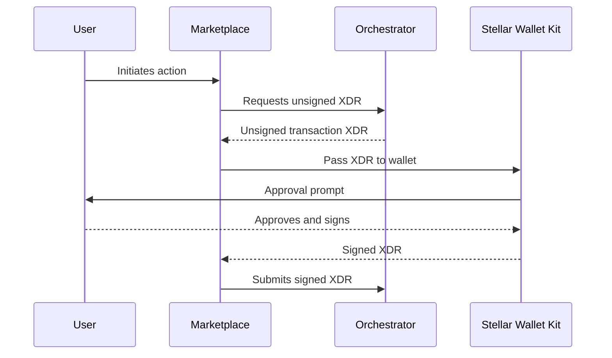

# Wallets Guide

> How the OFFER-HUB Orchestrator connects users to Stellar wallets and separates user signing from platform signing.

> **Audience:** This is the internal engineering reference for teams operating the Orchestrator. For public integration docs, see [`content/docs/guide/wallets.mdx`](../../content/docs/guide/wallets.mdx).

## Overview

The Orchestrator supports two wallet classes:

| Wallet type | Environment | Custody and signing |
|---|---|---|
| `EXTERNAL` | Mainnet and testnet | User-owned Stellar wallet; user signs client-side |
| `INVISIBLE` | Testnet sandbox only | Legacy sandbox custody model; not used on mainnet |

On mainnet, every supported user wallet is `EXTERNAL`. The user owns and controls the wallet through Stellar Wallets Kit. The server never receives the user's private key and never signs external-user transactions on the user's behalf.

## Supported wallet integrations

Users connect through Stellar Wallets Kit:

- Freighter (now branded Varial)
- Lobstr
- xBull

## Authentication

Wallet endpoints require a 7-day user-session JWT:

```http
Authorization: Bearer <user-session-jwt>
```

The JWT is produced by wallet challenge/verify, email/password authentication, or OAuth callback. It is independent from marketplace API-key tokens.

## Endpoint inventory

| Method | Path | Auth | Request | Response |
|---|---|---|---|---|
| `GET` | `/api/v1/wallet` | JWT | No body or path parameters | Wallet overview |
| `GET` | `/api/v1/wallet/readiness` | JWT | No body or path parameters | Readiness status |
| `GET` | `/api/v1/wallet/wallets` | JWT | No body or path parameters | Connected-wallet list |
| `GET` | `/api/v1/wallet/dashboard` | JWT | No body or path parameters | Dashboard summary |
| `GET` | `/api/v1/wallet/transactions` | JWT | SDK-published pagination/query fields | Transaction list and pagination |
| `POST` | `/api/v1/wallet/connect` | JWT | SDK-published connection fields | Connected wallet |
| `POST` | `/api/v1/wallet/disconnect` | JWT | SDK-published wallet identity fields | Disconnection result |
| `POST` | `/api/v1/wallet/reconnect` | JWT | SDK-published wallet identity fields | Reconnection result |
| `POST` | `/api/v1/wallet/set-primary` | JWT | SDK-published wallet identity fields | Primary-wallet result |
| `POST` | `/api/v1/wallet/claim` | JWT | Testnet sandbox only; SDK-published claim fields | Sandbox claim result |

## Signing model

The server prepares unsigned Stellar transactions as XDR. The marketplace passes the XDR to the user's Stellar wallet, and the user approves the transaction. The marketplace submits the signed XDR back to the Orchestrator/network.



Server-side user-signing routes are removed. No route decrypts or loads a user private key to sign on that user's behalf.

### Platform signing

Only the platform signer signs with the platform key. Platform signing is limited to platform-authorized operations such as neutral dispute resolution and other orchestrator-managed platform actions. It does not sign for an external user's general wallet operations.

## Wallet connection lifecycle

1. The user selects Freighter/Varial, Lobstr, or xBull in Stellar Wallets Kit.
2. The marketplace sends the wallet connection request with the user's JWT.
3. The Orchestrator stores the wallet association and public Stellar account data.
4. The wallet readiness and dashboard endpoints report connection and network readiness.
5. Transactions are prepared as unsigned XDR and signed client-side.

## Testnet sandbox: invisible wallets

Invisible wallets existed only on the testnet sandbox. They are not a mainnet feature.

The sandbox-only `POST /api/v1/wallet/claim` route starts or completes the claim flow for a sandbox wallet. The claim window is 90 days.

After the claim window or when migrating away from sandbox, users connect an external wallet rather than relying on a custodial wallet.

## SDK

The `@offerhub/sdk` 3.0.0 wallet resource is intended for user sessions:

```typescript
const userSdk = sdk.asUser(userSessionJwt);

await userSdk.wallet.getReadiness();
await userSdk.wallet.getWallets();
await userSdk.wallet.getDashboard();
await userSdk.wallet.getTransactions({ /* published SDK params */ });
```

Use `sdk.auth.walletChallenge` and `sdk.auth.walletVerify` with Stellar Wallets Kit. The maintainer is publishing 3.0.0 to npm; until then, confirm any exact signature in the issue thread before implementation.

## User types

| Type | Meaning |
|---|---|
| `BUYER` | Buys marketplace services or goods |
| `SELLER` | Sells marketplace services or goods |
| `BOTH` | Performs both buyer and seller roles |

## Related guides

- [Authentication & Credentials](../../content/docs/api-reference/authentication.mdx)
- [Auth Endpoints](../../content/docs/api-reference/auth.mdx)
- [Wallet SDK Reference](../../content/docs/sdk/wallet.mdx)
